<p align="center">
  <picture>
    <source media="(prefers-color-scheme: dark)" srcset="docs/assets/readme/hero-dark.png">
    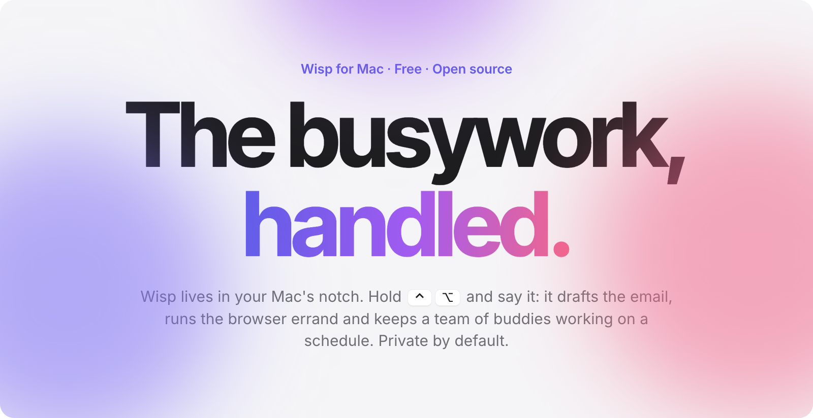
  </picture>
</p>

<p align="center">
  <a href="https://anaylab.github.io/wisp/"></a>
  <a href="#get-wisp"></a>
  <a href="#privacy"></a>
  <a href="LICENSE"></a>
</p>

<p align="center">
  <a href="#a-day-with-wisp"><b>A day</b></a> &nbsp;·&nbsp;
  <a href="#a-team-that-works-without-you"><b>Buddies</b></a> &nbsp;·&nbsp;
  <a href="#everything-it-does"><b>Features</b></a> &nbsp;·&nbsp;
  <a href="#privacy"><b>Privacy</b></a> &nbsp;·&nbsp;
  <a href="#get-wisp"><b>Get Wisp</b></a> &nbsp;·&nbsp;
  <a href="#faq"><b>FAQ</b></a>
</p>

<br>

<a id="a-day-with-wisp"></a>
<p align="center">
  <picture>
    <source media="(prefers-color-scheme: dark)" srcset="docs/assets/readme/day-dark.png">
    
  </picture>
</p>

<p align="center">
  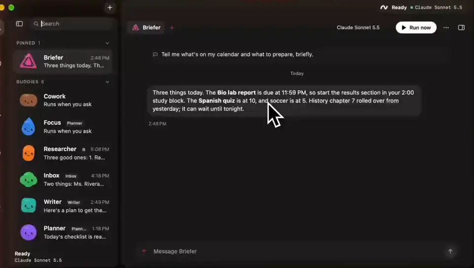
  <br><sub><b>9:00 AM.</b> The Briefer reads your calendar and hands its brief to the Writer, who turns it into a plan. Nobody asked.</sub>
</p>

<br>

<table>
<tr>
<td width="56%">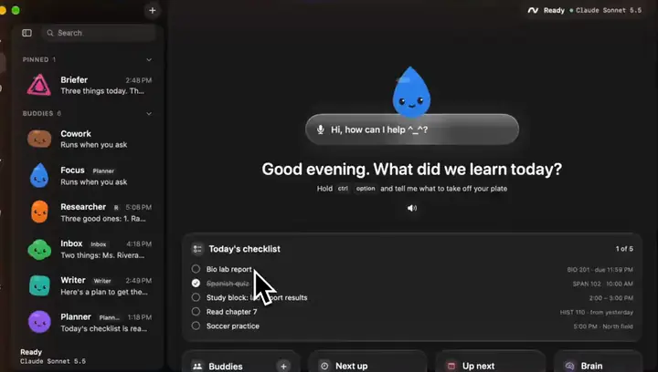</td>
<td width="44%" valign="middle">

<sub><b>7:30 AM</b></sub>
### Your day, already planned
Canvas deadlines and calendar events become one checklist in Reminders before you're up. **Today** shows it beside what your buddies are doing and what's coming next.

</td>
</tr>
<tr>
<td width="44%" valign="middle">

<sub><b>9:05 AM</b></sub>
### Say it once
*"Every weekday at 8, tell me what's due."* It becomes an automation card you can check before saving, and it says plainly when something would leave your Mac.

</td>
<td width="56%">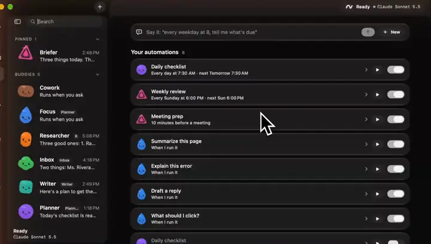</td>
</tr>
<tr>
<td width="56%">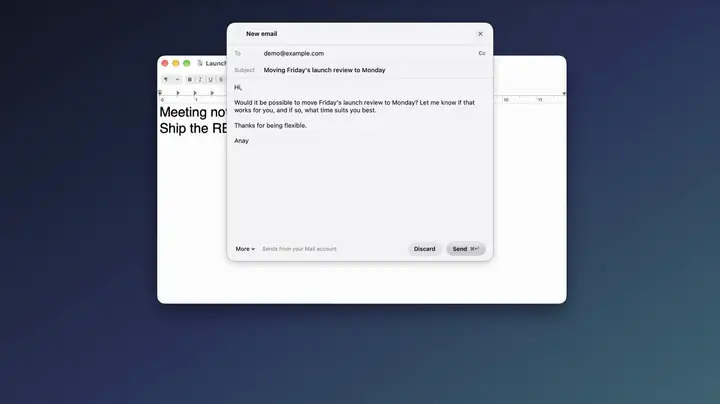</td>
<td width="44%" valign="middle">

<sub><b>10:15 AM</b></sub>
### An email, drafted
*"Draft an email to Sam about moving Thursday's session."* A finished draft opens, addressed from Contacts. Nothing leaves until you press **Send**.

</td>
</tr>
<tr>
<td width="44%" valign="middle">

<sub><b>12:40 PM</b></sub>
### An errand in your browser
*"Open Wikipedia and search for the Enigma machine."* Wisp works in its own tab, never the one you're reading, and tells you where it landed.

</td>
<td width="56%">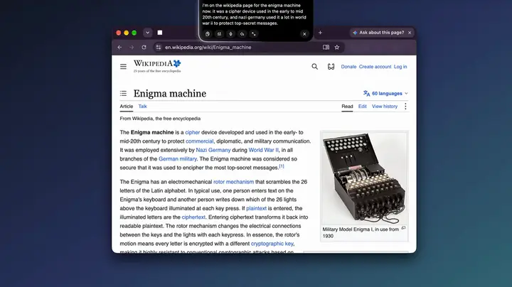</td>
</tr>
<tr>
<td width="56%">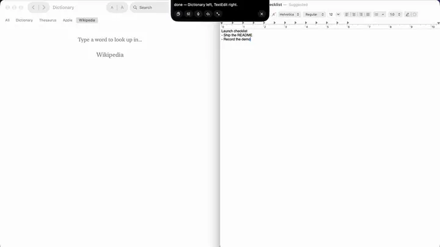</td>
<td width="44%" valign="middle">

<sub><b>2:00 PM</b></sub>
### Your desk, tidied by voice
*"Put Dictionary on the left and TextEdit on the right."* Done in a tenth of a second, with no model call.

</td>
</tr>
<tr>
<td width="44%" valign="middle">

<sub><b>4:30 PM</b></sub>
### Stuck? It walks you through
How-to answers become steps on your real screen. Wisp ticks them off as you click, and can click for you, but never anything irreversible.

</td>
<td width="56%">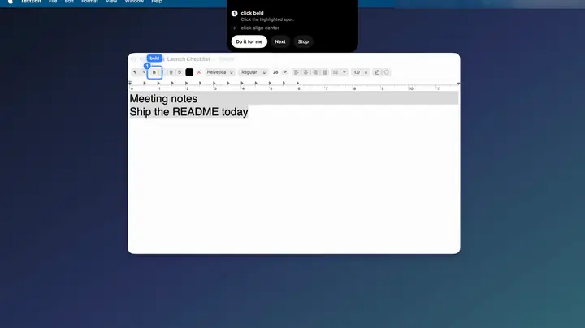</td>
</tr>
<tr>
<td width="56%">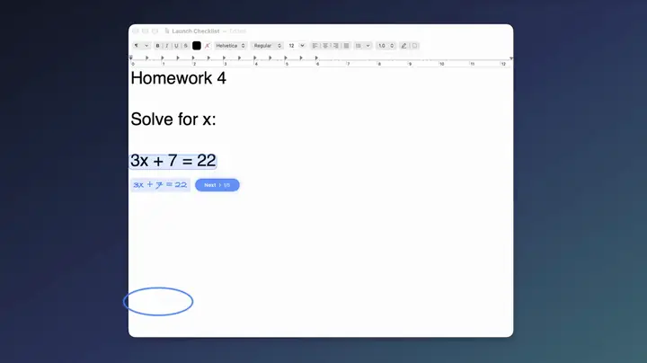</td>
<td width="44%" valign="middle">

<sub><b>8:00 PM</b></sub>
### Homework, worked on the page
Point it at a problem and it writes the working beside it, line by line. Save the finished page as a PNG with a Markdown summary.

</td>
</tr>
<tr>
<td width="44%" valign="middle">

<sub><b>All day</b></sub>
### You approve what matters
Anything that sends, deletes, pays, posts or runs a command shows a card first, even with auto-approve on. Edit the wording right on the card.

</td>
<td width="56%">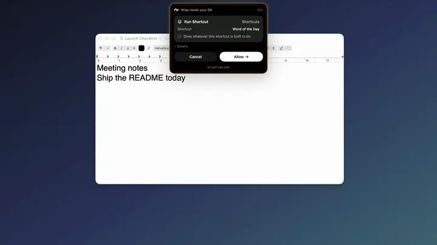</td>
</tr>
</table>

<br>

<p align="center">
  <picture>
    <source media="(prefers-color-scheme: dark)" srcset="docs/assets/readme/numbers-dark.png">
    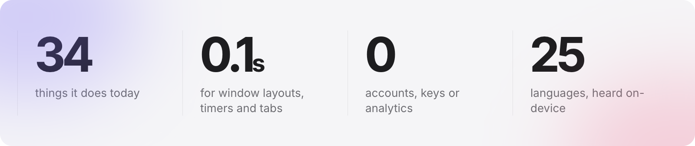
  </picture>
</p>

<br>

<a id="a-team-that-works-without-you"></a>
<p align="center">
  <picture>
    <source media="(prefers-color-scheme: dark)" srcset="docs/assets/readme/team-dark.png">
    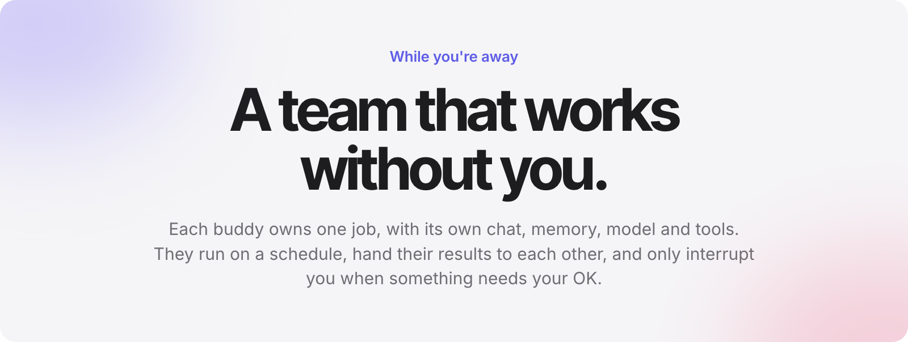
  </picture>
</p>

<table>
<tr>
<td width="50%">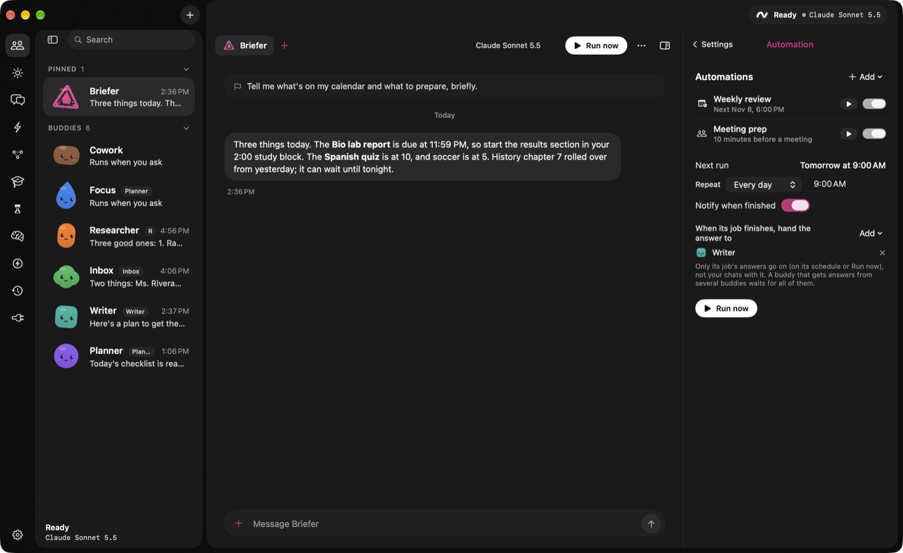</td>
<td width="50%">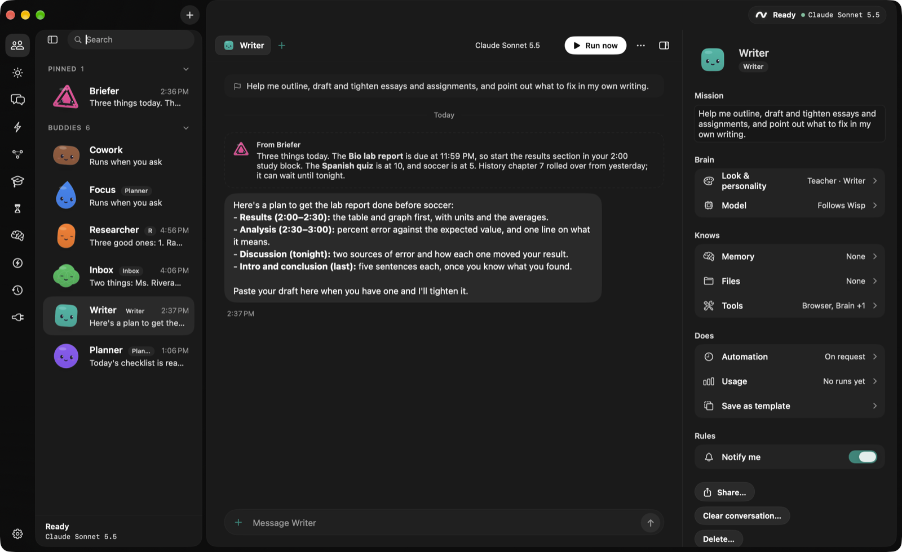</td>
</tr>
</table>

| | |
|---|---|
| **Hand off the answer** | When a buddy's job finishes, its answer goes to the buddies you chose. A buddy with several inputs waits for all of them, and a link that would leave your Mac asks first. |
| **Ask the team** | List teammates, ask up to four at once, split work into side threads, or draft a new buddy, always with your OK and never with more access than its own. |
| **Threads side by side** | Each chat runs on its own, with up to two side threads beside the main one. A message sent mid-job can wait or steer the work in progress. |
| **Backup models** | If a model hits a limit or goes down before answering, a backup takes over. A cloud backup counts as leaving your Mac from the start. |
| **A session of its own** | Run a buddy on your Claude subscription with a kept Claude Code session per conversation, started fresh when it gets close to full. |
| **Tidies its own notes** | Every 20 messages a buddy reviews what it remembered and fixes it. Notes you wrote are never touched. |
| **Automations** | Trigger → source → action → output → notify, set up by saying it, a template, or an answer from History. Scheduled runs only get tools that never prompt. |

<br>

<a id="everything-it-does"></a>
<p align="center">
  <picture>
    <source media="(prefers-color-scheme: dark)" srcset="docs/assets/readme/features-dark.png">
    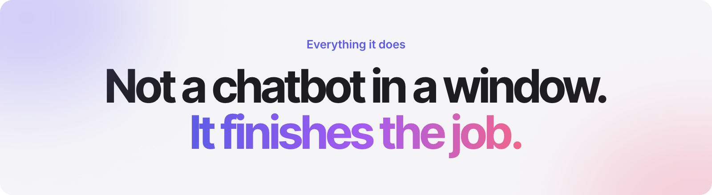
  </picture>
</p>

<table>
<tr>
<td width="33%" valign="top">

**Do**
- Draft emails, sent only by you
- Text people through Messages
- Browser errands in their own tab
- Group and dedupe Chrome tabs
- Arrange windows by voice
- Timers and music, instantly
- Apple Shortcuts, always with your OK
- Click and type in native apps

</td>
<td width="33%" valign="top">

**See & show**
- Point at any control in ~0.1s
- Walk you through, or do it for you
- Handwritten working on the page
- Note cards you can ask follow-ups on
- Ask about one part of the screen
- Screen watchers: *"tell me when it says Done"*
- Glance cards for weather, places, calendar

</td>
<td width="33%" valign="top">

**Plan**
- Canvas deadlines into your calendar
- A daily checklist in Reminders
- Study blocks, written only after OK
- Study mode that holds back distractions
- Automations on a schedule or an event

</td>
</tr>
<tr>
<td width="33%" valign="top">

**Team**
- Buddies with their own job and memory
- Hand-offs between buddies
- Group chats with `@name` routing
- Workflows drawn on a canvas
- Backup models

</td>
<td width="33%" valign="top">

**Remember**
- A private brain, Obsidian-compatible
- Buddy memory that tidies itself
- Learned shortcuts, replayed with no model
- A usage log of counts, never content

</td>
<td width="33%" valign="top">

**Connect**
- Ollama, Apple on-device, Claude, GPT, Gemini, Grok, OpenRouter
- 500+ apps through MCP and Composio
- Dictation into any app, 25 languages
- Hands-free with a double-tap of <kbd>⌃</kbd>

</td>
</tr>
</table>

<details>
<summary><b>Pointing, asking about a part, the brain and plug-ins, in more detail</b></summary>

### 🎯 Point at anything

Ask "where is the pi button?" and a pulsing, labelled marker lands on the exact control in about a tenth of a second. Wisp matches your words against the app's Accessibility tree and on-device OCR, so it works in native apps, terminals, images and remote desktops.

<p align="center">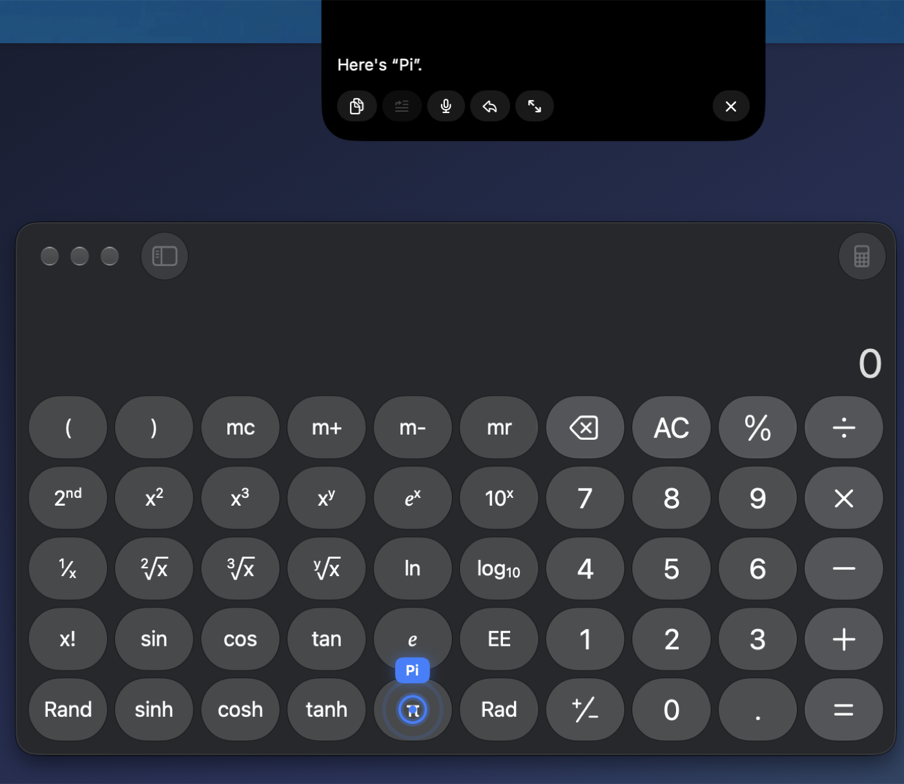</p>

### ✂️ Ask about just a part

Drag a box around anything on screen, or just say "explain option C". Wisp highlights exactly what you chose, and the follow-ups ("why?", "next step") stay about that region.

<table>
<tr>
<td width="50%">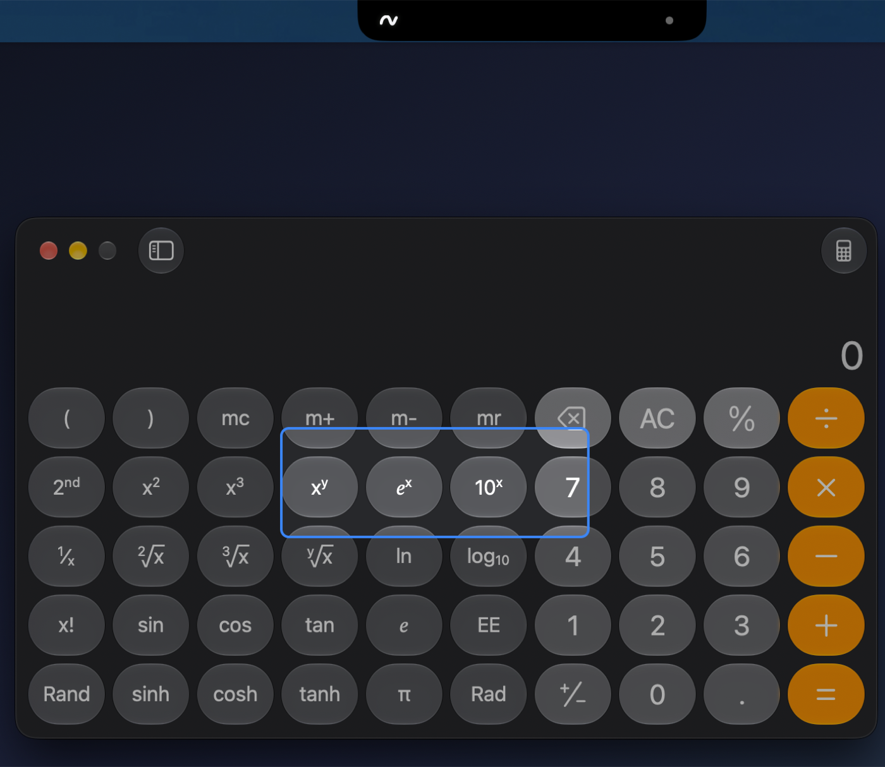</td>
<td width="50%">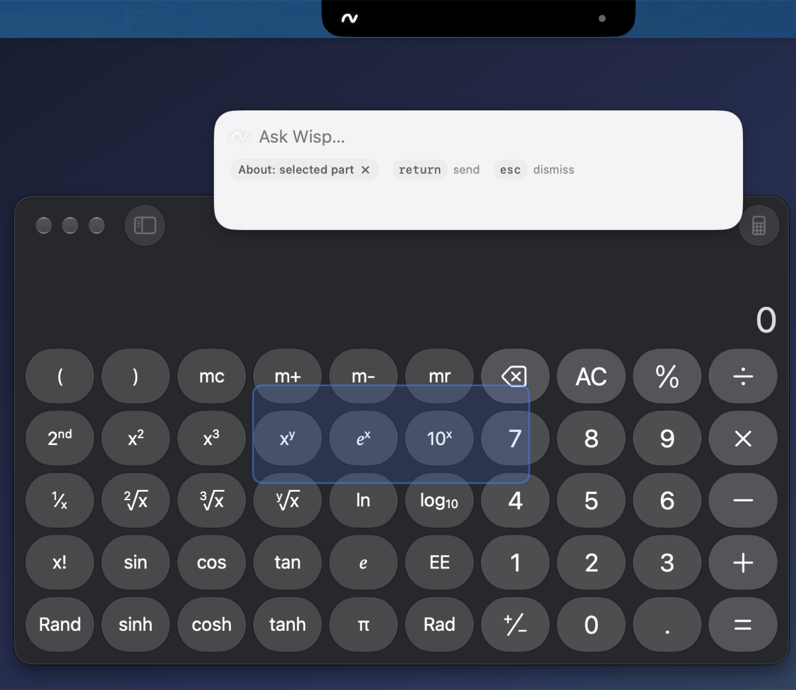</td>
</tr>
</table>

### 🧠 A private second brain

Wisp keeps a local wiki about you and your work in `~/.wisp/brain/`: plain markdown and a valid [Obsidian](https://obsidian.md) vault. Drop in files, PDFs and pages, import notes, and each turn gets context from the most relevant pages. Nothing edits a page directly; every write is a validated proposal, and **every change is one Undo**.

### 🔌 Plugs into everything

Install MCP servers from a built-in marketplace, connect 500+ apps through optional Composio, run Apple Shortcuts, and operate native Mac apps. Only the few tools relevant to each request reach the model.

<table>
<tr>
<td width="50%">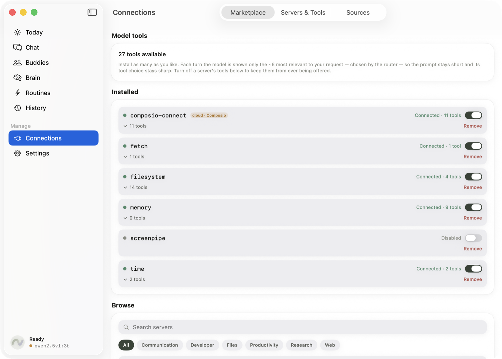</td>
<td width="50%">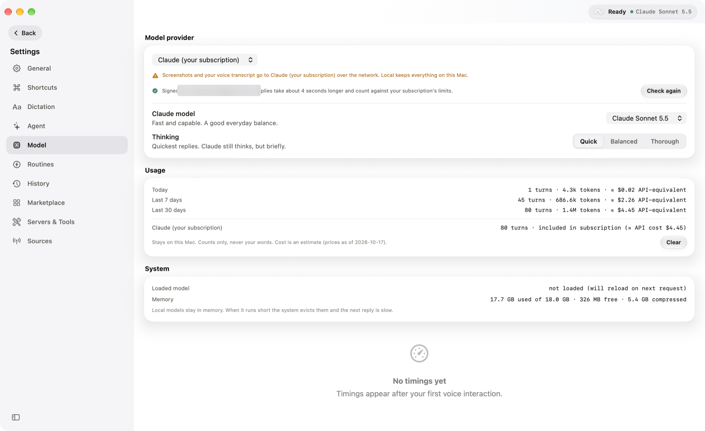</td>
</tr>
</table>

</details>

<br>

<a id="privacy"></a>
<p align="center">
  <picture>
    <source media="(prefers-color-scheme: dark)" srcset="docs/assets/readme/privacy-dark.png">
    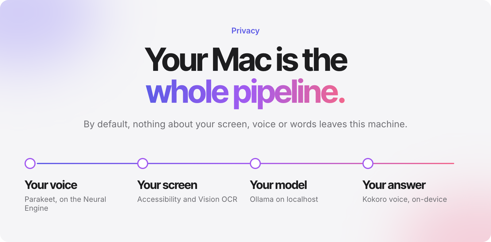
  </picture>
</p>

<table>
<tr>
<td width="33%" valign="top">

### Local first
The default model runs on your Mac through Ollama. Brain pages are plain markdown files on your disk.

</td>
<td width="33%" valign="top">

### Cloud is opt-in
Claude, GPT and Gemini are bring-your-own-key, or use your Claude subscription. Wisp labels clearly when a screenshot would leave your Mac.

</td>
<td width="33%" valign="top">

### Nothing to track you
No account, no analytics code, no telemetry. Keys and feed URLs live in your login Keychain. The usage log keeps counts, never content.

</td>
</tr>
</table>

<details>
<summary><b>What runs where, in detail</b></summary>

| | Default | Opt-in |
|---|---|---|
| Speech to text | Parakeet on the Neural Engine, on-device | — |
| Answers and vision | Ollama on `localhost:11434` | Apple on-device model, or your own Anthropic, OpenAI or Gemini key |
| Voice | Kokoro on the Neural Engine, on-device | A local Chatterbox server |
| Screen reading | Vision OCR + Accessibility, on-device | — |
| Brain | Markdown on your disk | Activity feed (off by default, local model only) |
| Network | `localhost`, a one-time speech-model download, key-free weather/places lookups and a daily update check, each of which you can turn off | Only the provider, Canvas feed or source you enable |
| Secrets | none needed | Keys and feed URLs live in your login Keychain |
| Analytics | **none** | none |

Images are never written to disk in conversation history. Weather and places cards send only a place name or query, never a screenshot. The usage log keeps token counts and timings, never content.

Images are never written to disk in conversation history. Weather and places cards send only a place name or query, never a screenshot.

</details>

<br>

<a id="get-wisp"></a>
<p align="center">
  <picture>
    <source media="(prefers-color-scheme: dark)" srcset="docs/assets/readme/get-dark.png">
    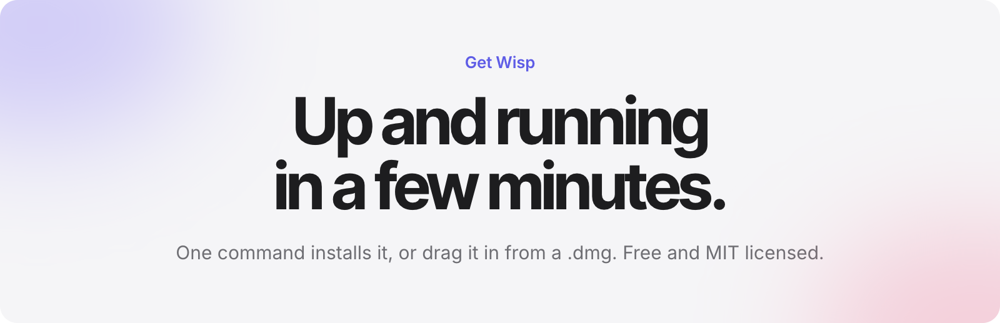
  </picture>
</p>

You need an Apple-silicon Mac on **macOS 26+**, **Xcode 26**, and [Ollama](https://ollama.com/download) for the default local model.

```bash
# 1. a local model
ollama pull qwen2.5vl:3b

# 2. get Wisp
git clone https://github.com/anaylab/wisp.git && cd wisp
open leanring-buddy.xcodeproj

# 3. pick the leanring-buddy scheme and press ⌘R, then hold ⌃⌥ and talk
```

Wisp appears in the menu bar (there is no Dock icon) and opens on **Today** with a checklist of the permissions it needs. Grant them, hold <kbd>Control</kbd> + <kbd>Option</kbd>, and talk. The first launch downloads the on-device speech models once; until they are ready, Apple's built-in engines stand in.

> [!NOTE]
> The Xcode project and scheme keep their original `leanring-buddy` name, typo included. Only the app is called Wisp. Please don't rename them.

<details>
<summary><b>Install it in /Applications, and what not to do</b></summary>

```bash
./scripts/install.sh     # copies your Xcode build to /Applications without re-signing, so permissions survive
open -a Wisp
```

Don't launch `Wisp.app/Contents/MacOS/Wisp` from a shell (speech recognition then crashes on the first push-to-talk), and don't build with `xcodebuild` from the terminal (it re-signs the app and resets its privacy permissions). Build in Xcode instead.

</details>

<br>

<a id="faq"></a>
<p align="center">
  <picture>
    <source media="(prefers-color-scheme: dark)" srcset="docs/assets/readme/faq-dark.png">
    
  </picture>
</p>

<details><summary><b>Is it really free?</b></summary>

Yes. Wisp is open source under the MIT license, and the default setup costs nothing to run because the model, speech and voice are all on your Mac. If you choose a cloud model, you pay that provider with your own key or subscription.

</details>
<details><summary><b>What leaves my Mac?</b></summary>

By default, nothing you say or see. Speech to text, voice, OCR and the local model all run on-device. The only network use by default is a one-time download of the speech models, optional weather and places lookups, which send a place name or query, never a screenshot, and, in downloaded builds, a daily update check that tells GitHub your IP address and Wisp's version. If you pick a cloud model, your transcript and screenshots go to that provider, and Wisp says so.

</details>
<details><summary><b>Can it do something I didn't want?</b></summary>

Anything that sends, deletes, pays, posts, invites or runs a command shows a card first, even if you turned on auto-approve, and you can edit the wording before you allow it. Password and payment fields in the browser are refused outright. Scheduled automations only get tools that never prompt.

</details>
<details><summary><b>Which Macs does it need?</b></summary>

An Apple-silicon Mac on macOS 26 or later, since the notch uses Liquid Glass. 16 GB of memory is recommended for the local model. You need Xcode 26 to build it.

</details>
<details><summary><b>Does it work in my apps?</b></summary>

Pointing, walkthroughs and screen reading work anywhere: native apps through Accessibility and everything else through on-device OCR. Browser control works with Chrome and Safari.

</details>
<details><summary><b>Why isn't there a download button?</b></summary>

There is no notarized build published yet, and I'd rather say so than point you at something half-finished. Building it takes a few minutes in Xcode, and signed releases are on the way.

</details>

<br>

<p align="center">
  <picture>
    <source media="(prefers-color-scheme: dark)" srcset="docs/assets/readme/closing-dark.png">
    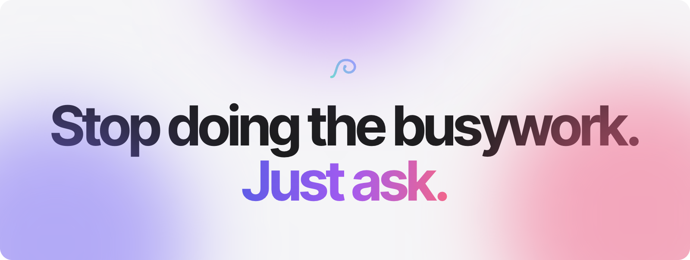
  </picture>
</p>

<p align="center">
  <a href="#get-wisp"><b>Get Wisp</b></a> &nbsp;·&nbsp; <a href="https://anaylab.github.io/wisp/"><b>See it move</b></a> &nbsp;·&nbsp; <a href="https://github.com/anaylab/wisp/stargazers"><b>Star on GitHub</b></a>
</p>

<br>

---

<p align="center"><sub><b>UNDER THE HOOD</b></sub></p>

## Say it

Hold <kbd>⌃</kbd><kbd>⌥</kbd> and talk, or tap it to type. The ⚡ rows never touch the model.

| You say | Wisp does | |
|---|---|:---:|
| *"Where's the export button?"* | Drops a pulsing marker on it | ⚡ |
| *"Put Safari on the left and Xcode on the right"* | Tiles both windows | ⚡ |
| *"Tell me when the build finishes"* | Watches the screen and pings you | ⚡ |
| *"Set a timer for 10 minutes"* | A live countdown card in the notch | ⚡ |
| *"Organize my tabs"* | Groups and tidies Chrome | ⚡ |
| *"Add this page to my brain"* | Files the front tab into your local wiki | ⚡ |
| *"Walk me through turning on FileVault"* | Numbered boxes over System Settings | 🧠 |
| *"Solve this"* | Handwritten working beside the problem | 🧠 |
| *"Draft an email to Sam about Friday"* | An editable draft, sent only when you press Send | 🧠 |
| *"Every morning, summarise what's due today"* | A buddy that does it on schedule | 🧠 |

## Models

Local is the default and the private path. Choose the brain in **Settings → Model**, and give any buddy its own.

| Provider | Runs | Needs |
|---|---|---|
| **Ollama** (default) | On your Mac | `qwen2.5vl:3b` |
| **Apple on-device** | On your Mac | Apple Intelligence |
| **Claude** (your key) | Anthropic | API key in Keychain |
| **Claude** (your subscription) | Your `claude` CLI | A signed-in `claude`, no API key |
| **GPT** / **Gemini** | OpenAI / Google | API key in Keychain |

## How it works

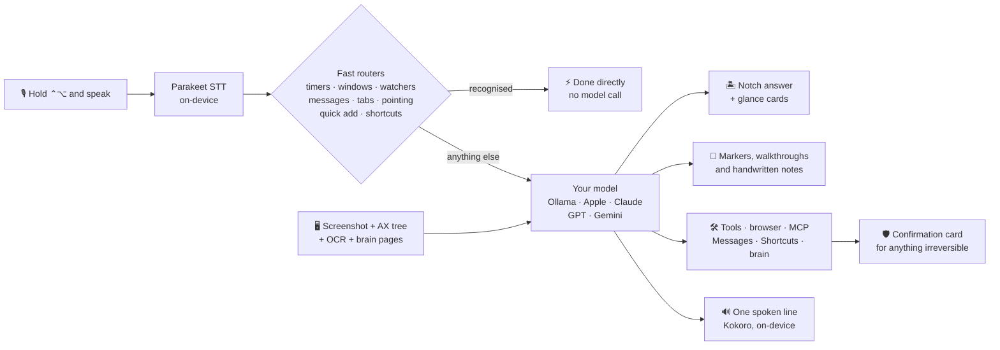

Small local models are slow at looking at pictures, so Wisp avoids asking them to. Measured on an M3 Pro:

| | Typical approach | Wisp |
|---|---|---|
| Point at a button | Screenshot → vision model guesses pixels: **~4s**, often wrong | Accessibility + OCR match: **~0.1s** |
| Screenshot cost | 1280px ≈ 4,049 tokens | 896px ≈ **1,095 tokens**, reused when the screen hasn't changed |
| Simple browser task | Model plans every step | Deterministic planner first: **~1s**, no model |
| Screen text | Ask the model to read it | Vision OCR in **~170ms**, started while you're still talking |
| Speech to text | Wait for the whole clip | Parakeet: **~120–300ms** from release to final transcript |
| Speaking a reply | Synthesise the whole answer | Kokoro: first audio in **~300ms**, sentence by sentence |

<details>
<summary><b>Configuration, files and optional extras</b></summary>

Almost everything lives in the Wisp window. Shipped defaults are in [`leanring-buddy/Info.plist`](leanring-buddy/Info.plist):

| Key | Default | Notes |
|---|---|---|
| `ChatProvider` | `ollama` | Default hint only; pick a provider in Settings → Model |
| `OllamaModel` | `qwen2.5vl:3b` | Bigger models point better but answer slower |
| `VoiceTranscriptionProvider` | `fluidaudio` | Parakeet; `apple` for Apple Speech only |
| `VoiceTTSProvider` | `fluid` | Kokoro; `apple` for macOS voices, `chatterbox` for a local server |
| `AgentModeEnabled` | `true` | Lets the model call tools; risky actions always ask |

| Path | What it is for |
|---|---|
| `~/.wisp/mcp.json` | MCP servers, in Claude Desktop's format |
| `~/.wisp/sources.json` | Your own HTTPS endpoints for glance cards |
| `~/.wisp/skills/*.md` | Skills: only their names cost tokens until one is loaded |
| `~/.wisp/brain/` | The brain: an Obsidian-compatible markdown vault |
| `~/Library/Application Support/Wisp/` | History, buddies, automations, routines, learned shortcuts, usage log |

**Extras:** load [`chrome-extension/`](chrome-extension) unpacked for tab organizing (it talks to Wisp over a loopback-only WebSocket that accepts only that extension); install [cua-driver](https://github.com/trycua/cua) to operate native apps (every click still asks); paste a Canvas feed URL on the Canvas page (kept only in your Keychain).

</details>

## Development

[`AGENTS.md`](AGENTS.md) is the full architecture reference: every subsystem, key file and convention. Start there before changing anything.

```bash
# Unit tests: in Xcode, press ⌘U
log stream --predicate 'process == "Wisp"'     # logs from a running copy
./Tests/FastPointing/run.sh                    # standalone suites: plain swiftc, no Xcode, no permission reset
./scripts/demo.sh                              # run Wisp on sample data for screenshots (--reset, --off)
```

<details>
<summary><b>Project layout and test suites</b></summary>

```text
leanring-buddy/           the app (Swift / SwiftUI + AppKit, ~350 files)
├── DesignSystem/         colour, type, spacing, motion tokens and themes
├── Components/           Wisp mark, glass panels, bento tiles, icon system
├── DynamicIsland/        notch island, quick chat, morning briefing, quiet mode
├── WispWindow/           the Wisp window: Today, Chat, Buddies, Automations, Canvas, Settings
├── Brain/                the local wiki: pages, search, ingest, digests, lint
├── Buddies/              agents: threads, memory, models, tools, delegation, characters
├── Automations/          trigger → source → action → output engine
├── Jobs/                 Canvas calendar sync and the daily checklist
├── LearnedShortcuts/     save and replay a finished turn with no model
├── WindowManagement/     voice window layout
├── Email/                editable drafts and Mail sending
└── …                     providers, dictation, screen capture + OCR, agent loop, tools, MCP
Tests/                    37 standalone suites
chrome-extension/         Wisp Tabs extension for Chrome
scripts/                  install, update, demo and release scripts
docs/                     design docs and brand assets
```

```bash
./Tests/ModelProviderContract/run.sh     # provider layer
./Tests/AgentRuntimeIntegration/run.sh   # the agent loop, against the whole app
./Tests/BrowserReplyGrounding/run.sh     # browser task replies match the page
./Tests/FastPointing/run.sh              # "where is X" parsing and matching
./Tests/GuidedWalkthrough/run.sh         # walkthrough stepping and click matching
./Tests/WindowManagement/run.sh          # window commands, app matching, frame math
./Tests/AutomationEngine/run.sh          # unattended safety and approvals
./Tests/BrainCore/run.sh                 # brain pages, edit planner, search
```

The full list is in [`AGENTS.md`](AGENTS.md).

</details>

## Brand

The mark is a curling wisp that ends in an orb: a thought, caught mid-air. The wordmark is lowercase Sora Light with a hand-drawn swish.

<table>
<tr>
<td align="center" width="50%" bgcolor="#FFFFFF">
  <picture>
    <source media="(prefers-color-scheme: dark)" srcset="docs/assets/brand/lockup-dark.png">
    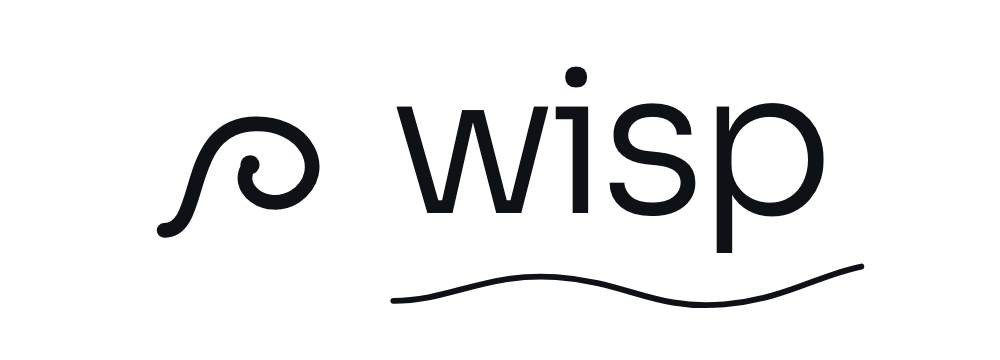
  </picture>
</td>
<td align="center" width="25%">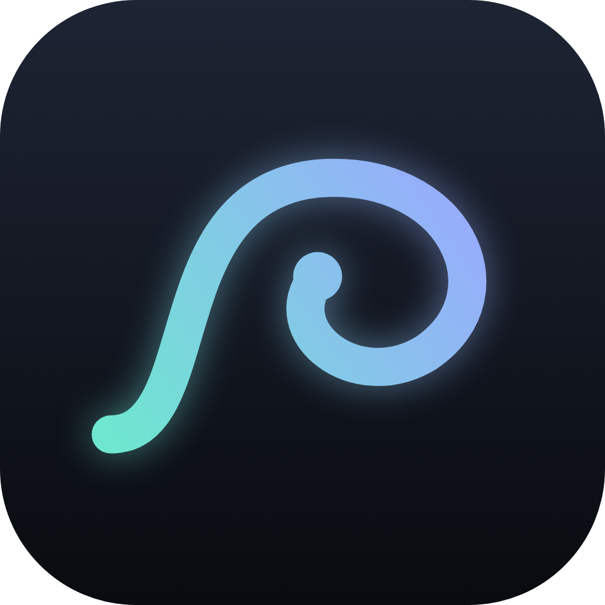</td>
<td align="center" width="25%">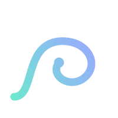</td>
</tr>
</table>

| Colour | Hex | Use |
|---|---|---|
| **Ink** | `#0E1116` | Text, mark on light, dark surfaces |
| **Mint** | `#6FE6D0` | Start of the signature gradient |
| **Periwinkle** | `#9AA9FF` | End of the signature gradient |

Assets live in [`docs/assets/brand/`](docs/assets/brand).

## Contributing

Issues and pull requests are welcome; see [CONTRIBUTING.md](CONTRIBUTING.md). Security issues go through [SECURITY.md](SECURITY.md), not public issues.

## License

MIT. See [LICENSE](LICENSE) for the copyright notices.

Created by [Anay Parwal](https://anayparwal.pages.dev/), a student developer in New Jersey. Read the [Wisp case study](https://anayparwal.pages.dev/wisp/).

<p align="center">
  <br>
  <sub>Made to stay out of your way.</sub>
</p>
