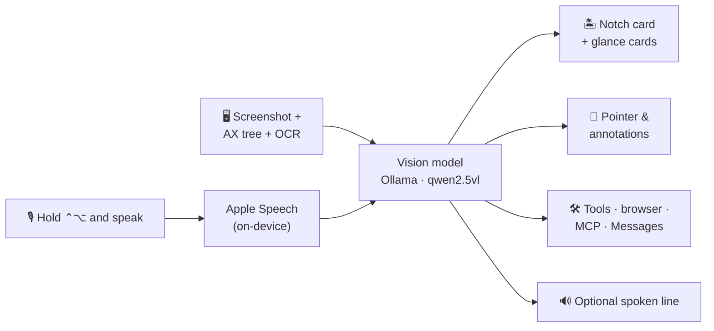

<p align="center">
  
</p>

<h1 align="center">Wisp</h1>

<p align="center">
  A private AI companion that lives in your Mac's notch.
</p>

<p align="center">
  <a href="#quick-start"></a>
  <a href="#quick-start"></a>
  <a href="#privacy"></a>
  <a href="LICENSE"></a>
</p>

<p align="center">
  <b>Hold <kbd>Control</kbd> + <kbd>Option</kbd>, ask anything, and Wisp answers —<br>
  looking at your screen, pointing at what it means, and doing the busywork for you.</b>
</p>

<p align="center">
  
</p>

---

Wisp is a menu bar–only AI companion for macOS. It lives in the notch like a Dynamic
Island, listens when you hold a hotkey, sees what's on your screen, and answers in a
compact card — speaking out loud if you want it to. It can point at buttons, draw
walkthroughs over your apps, drive your browser, text your contacts, and run small
scheduled agents in the background.

**It runs entirely on your Mac by default.** A local vision model through Ollama,
on-device speech recognition, on-device voices. No account, no API key, no analytics.
Cloud models are strictly opt-in, bring-your-own-key, and labelled as such.

## Contents

- [Screenshots](#screenshots)
- [Features](#features)
- [How it works](#how-it-works)
- [Quick start](#quick-start)
- [Privacy](#privacy)
- [Configuration](#configuration)
- [Project layout](#project-layout)
- [Development](#development)
- [Contributing](#contributing)
- [Credits](#credits)

## Screenshots

<p align="center">
  
  <br><sub><b>The Wisp window.</b> One native Mac window for everything you manage: today, chat, buddies, routines, history, connections and settings.</sub>
</p>

<p align="center">
  
  <br><sub><b>Menu bar and settings.</b> A plain native menu for the quick stuff; Settings shows every permission, the model that's answering and whether anything leaves your Mac.</sub>
</p>

## Features

### 🎙️ Talk to it
- **Push-to-talk** with <kbd>Control</kbd> + <kbd>Option</kbd>, from any app. On-device
  transcription with a live preview in the notch.
- **Custom dictionary and language** so names and jargon come out spelled right.
- **Voice or silent mode.** Every answer shows as text; in voice mode the model picks one
  short line worth saying out loud instead of reading the whole reply.
- Or just **type** — the notch has a full chat workspace with conversation history and search.

### 👀 It sees your screen
- **Pointing.** Ask "where's the export button?" and a pulsing marker lands on it — on any
  monitor.
- **Walkthroughs.** Boxes, arrows and highlights drawn over your live screen, auto-numbered
  into step-by-step guides.
- **Precise targeting** via the Accessibility tree for native apps and on-device OCR for
  everything else (terminals, images, remote desktops).

### 🏝️ Lives in the notch
- A **Dynamic Island–style** surface that wraps the physical notch and stays invisible when idle.
- **Glance cards** for weather, calendar, reminders, timers, now playing, nearby places,
  and your own HTTPS data sources.
- A **morning briefing** with a handful of one-click suggestions, and a **quiet mode** that
  stays out of the way when you're on a call.

### 🤖 Gets things done
- **Agent mode** with tools, background tasks and notifications when they finish.
- **Browser control** of your real Chrome or Safari, in its own tab, via the DOM — fast,
  and it never touches the tab you're using.
- **Messages & Contacts:** "text mom I'm running late" works like Siri.
- **Buddies:** named little agents that each own one recurring job ("every morning, summarise my calendar").
- **Wisp Tabs** Chrome extension to group, dedupe and tidy your tabs.
- **MCP client** with a built-in catalogue — plug in any stdio or remote MCP server.
- **Safe by design:** anything that sends, deletes, pays, posts or runs a command asks first,
  with a card showing exactly what will happen — even if you've turned on auto-approve.

## How it works



The model replies in plain text with small structured tags — `[POINT:…]`, `[BOX:…]`,
`[CARD:…]`, `[TOOL:…]`, `[SAY:…]` — that Wisp parses and turns into pointers, cards, tool
calls and speech. That keeps it working with small local models that can't do native
structured output.

## Quick start

**Requirements**

- Apple-silicon Mac running **macOS 26** or later (the notch uses Liquid Glass)
- 16 GB RAM recommended
- **Xcode 26**
- [Ollama](https://ollama.com/download)

**1. Pull the model**

```bash
ollama pull qwen2.5vl:3b
```

**2. Build and run**

```bash
git clone https://github.com/anaylab/wisp.git
cd wisp
open leanring-buddy.xcodeproj
```

Select the `leanring-buddy` scheme and press <kbd>⌘</kbd><kbd>R</kbd>. Wisp appears in
the menu bar (there's no Dock icon). Grant the permissions it asks for — Microphone,
Speech Recognition, Screen Recording and Accessibility — then hold
<kbd>Control</kbd> + <kbd>Option</kbd> and talk.

> [!NOTE]
> The Xcode project and scheme keep their original `leanring-buddy` name, typo included.
> Only the app is called Wisp — please don't rename them.

**3. Install it (optional)**

```bash
./scripts/install.sh
```

This copies your Xcode build into `/Applications` without re-signing it, so your granted
permissions survive. Launch it with `open -a Wisp`.

> [!WARNING]
> Don't launch `Wisp.app/Contents/MacOS/Wisp` directly from a shell, and don't build with
> `xcodebuild` from the terminal. The first skips LaunchServices registration (speech
> recognition then crashes on the first push-to-talk); the second re-signs the app and
> resets its privacy permissions.

**Better voices.** macOS ships compact voices that sound robotic. Enhanced and premium
voices are a free download in **System Settings → Accessibility → Spoken Content → System
Voice → Manage Voices**, and Wisp picks the best English one you have. For a more natural
voice you can also run a local [Chatterbox](https://github.com/resemble-ai/chatterbox) TTS
server on port 8004 and set `VoiceTTSProvider` to `chatterbox`.

## Privacy

| | Default | Opt-in |
|---|---|---|
| Speech to text | Apple Speech, on-device | — |
| Answers & vision | Ollama on `localhost:11434` | Your own Anthropic, OpenAI or Gemini key |
| Voice | macOS voices, on-device | Chatterbox on `localhost:8004` |
| Network traffic | `localhost` only | Only the provider or data source you enable |
| API keys | none needed | stored in your login Keychain |
| Analytics | none | none |

If you switch to a cloud model, Wisp labels it clearly: screenshots and transcripts then
leave your Mac. Weather and places cards use key-free public services and can be turned off
in **Sources**.

## Configuration

Most things live in the Wisp window (menu bar icon → **Open Wisp**, or **Open Wisp** in the
notch). Shipped defaults are
in [`leanring-buddy/Info.plist`](leanring-buddy/Info.plist):

| Key | Default | Notes |
|---|---|---|
| `ChatProvider` | `ollama` | Default hint only — pick a provider in Settings → Model |
| `OllamaModel` | `qwen2.5vl:3b` | Bigger models point more accurately but answer slower |
| `OllamaBaseURL` | `http://localhost:11434` | |
| `VoiceTranscriptionProvider` | `apple` | |
| `VoiceTTSProvider` | `apple` | `chatterbox` to use a local Chatterbox server |
| `ChatterboxTTSServerURL` | `http://localhost:8004` | |
| `AgentModeEnabled` | `true` | Lets the model call tools; risky actions always ask |

User files live in `~/.wisp/`:

| File | What it's for |
|---|---|
| `~/.wisp/mcp.json` | MCP servers, in the same format Claude Desktop uses |
| `~/.wisp/sources.json` | Your own HTTPS endpoints for glance cards |

## Project layout

```text
leanring-buddy/           the app (Swift / SwiftUI + AppKit)
├── DesignSystem/         colour, type, spacing, motion tokens
├── Components/           Wisp mark, glass panels, icon system
├── DynamicIsland/        notch HUD, chat workspace, morning briefing, quiet mode
├── Buddies/              scheduled background agents
└── …                     providers, dictation, screen capture, agent loop, tools
leanring-buddyTests/      unit tests
Tests/                    standalone contract and integration suites
chrome-extension/         Wisp Tabs extension for Chrome
scripts/                  install and release scripts
docs/                     design docs and brand assets
```

[`AGENTS.md`](AGENTS.md) is the full architecture reference — every subsystem, key file
and convention. Start there before making changes.

## Development

```bash
# Unit tests: in Xcode, press ⌘U

# Standalone suites (no Xcode build, no TCC reset)
./Tests/ModelProviderContract/run.sh
./Tests/AgentRuntimeIntegration/run.sh

# Logs from a running copy
log stream --predicate 'process == "Wisp"'
```

## Contributing

Issues and pull requests are welcome — see [CONTRIBUTING.md](CONTRIBUTING.md). Security
issues go through [SECURITY.md](SECURITY.md), not public issues.

## Credits

Wisp began as a fork of [Clicky](https://github.com/farzaa/clicky) by
[Farza](https://github.com/farzaa) and is MIT licensed accordingly. The original sends
voice, screenshots and conversations to cloud services through a Cloudflare Worker; Wisp
replaces all of that with models running on your Mac, and adds the notch island, the Wisp window,
screen annotation, agent loop, browser control, buddies, glance cards and MCP client.

Questions and bugs about Wisp belong here, not with the original author.

## License

MIT — see [LICENSE](LICENSE).
