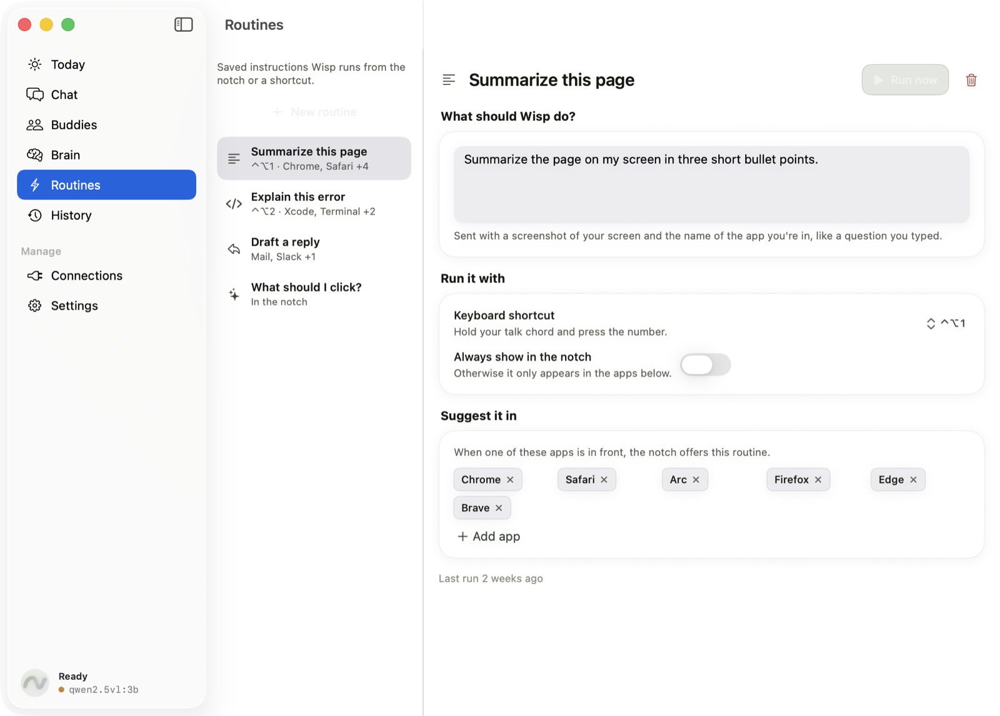
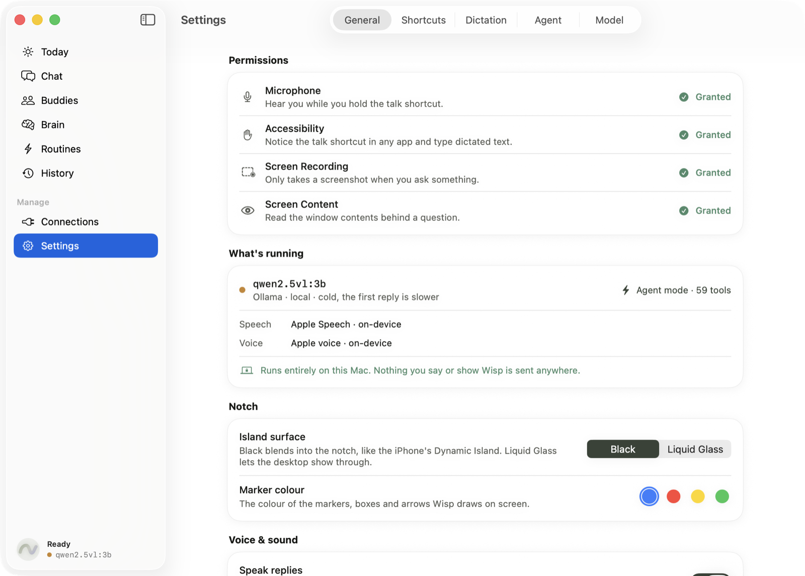
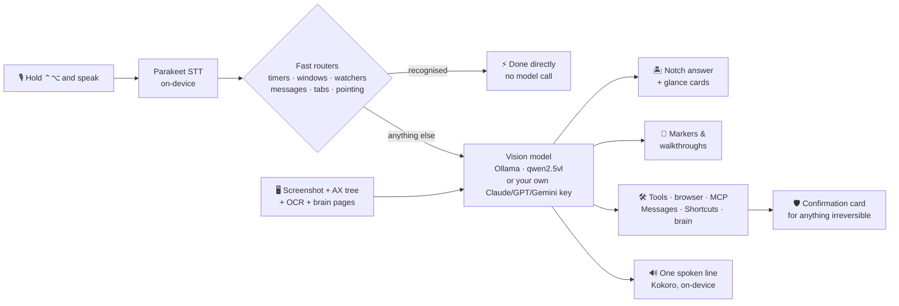

<p align="center">
  
</p>

<p align="center">
  <a href="#quick-start"></a>
  <a href="#quick-start"></a>
  <a href="#privacy"></a>
  <a href="#acts-for-you"></a>
  <a href="LICENSE"></a>
</p>

<h3 align="center">Hold <kbd>⌃</kbd> <kbd>⌥</kbd>, say what you want, let go.</h3>

<p align="center">
  Wisp looks at your screen, answers in the notch, points at what it means,<br>
  and quietly does the busywork. No account. No API key. Nothing leaves your Mac.
</p>

<p align="center">
  <a href="#quick-start"><b>Quick start</b></a> ·
  <a href="#try-saying">Try saying</a> ·
  <a href="#tour">Tour</a> ·
  <a href="#features">Features</a> ·
  <a href="#how-it-works">How it works</a> ·
  <a href="#privacy">Privacy</a> ·
  <a href="#brand">Brand</a>
</p>

<p align="center">
  
</p>

---

## What is Wisp?

Wisp is a **menu bar–only AI companion for macOS**. It lives in the notch like a Dynamic Island,
invisible until you need it. Hold a hotkey and it listens, sees what is on your screen, and answers in
a compact card. It can:

- **point** at the button you are looking for and draw walkthroughs over your apps
- **arrange windows**, **watch your screen** and tell you when a build finishes
- **drive your browser**, **text your contacts**, **draft emails**
- keep a **private wiki** of what it learns about you
- run **scheduled agents** (buddies) in the background

**It all runs on your Mac by default:** a local vision model through Ollama, on-device speech
recognition (Parakeet) and speech synthesis (Kokoro) on the Neural Engine, and on-device OCR. Cloud
models (Claude, GPT, Gemini) are strictly opt-in, bring-your-own-key, and labelled whenever they are on.

<table>
<tr>
<td align="center" width="25%"><h3>~0.1s</h3><sub>to point at a button, with no vision model</sub></td>
<td align="center" width="25%"><h3>0</h3><sub>accounts, API keys or analytics needed</sub></td>
<td align="center" width="25%"><h3>25</h3><sub>languages transcribed on-device</sub></td>
<td align="center" width="25%"><h3>500+</h3><sub>apps reachable through MCP and Composio</sub></td>
</tr>
</table>

## Try saying

Hold <kbd>⌃</kbd><kbd>⌥</kbd> and talk, or tap it to type. Many of these never touch the model at all:
Wisp recognises them and just does it.

| You say | Wisp does | Model? |
|---|---|:---:|
| *"Where's the export button?"* | Drops a pulsing marker on it, on whichever monitor it is on | ⚡ none |
| *"Put Safari on the left and Xcode on the right"* | Tiles both windows over Accessibility | ⚡ none |
| *"Tell me when the build finishes"* | Watches the screen and pings you when "Succeeded" appears | ⚡ none |
| *"Text mom I'm running late"* | Finds Mom in Contacts, shows a Siri-style card, sends on your OK | ⚡ none |
| *"Draft an email to Sam about moving Friday's meeting"* | Opens an editable draft; nothing is sent until you press Send | 🧠 one call |
| *"Set a timer for 10 minutes"* | A live countdown card in the notch | ⚡ none |
| *"Organize my tabs"* / *"Close duplicate tabs"* | Groups and tidies Chrome via the Wisp Tabs extension | ⚡ none |
| *"Explain the third answer"* | Selects that part of the screen and explains just that | 🧠 yes |
| *"Add this page to my brain"* | Reads the front tab and files it into your local wiki | ⚡ none |
| *"Open github and search for swift markdown"* | Drives your real browser, in its own tab | 🧠 sometimes |
| *"Walk me through turning on FileVault"* | Numbered boxes and arrows drawn over System Settings | 🧠 yes |
| *"What's the weather in Lisbon?"* | An Apple Weather–style glance card | 🧠 yes |
| *"Every morning, summarise what's due today"* | Creates an automation that does exactly that, on schedule | 🧠 yes |
| *"Run my Log Water shortcut"* | Runs an Apple Shortcut, after asking | 🧠 yes |

## Tour

<p align="center">
  
  <br><sub><b>Today.</b> A live bento dashboard: ask bar, what Wisp did today, your buddies, your next meeting, the brain, one-click routines and recent answers.</sub>
</p>

<p align="center">
  
  <br><sub><b>Menu bar and settings.</b> A plain native menu for the quick things, including Pause Listening. Settings shows every permission, the model that is answering, and whether anything leaves your Mac.</sub>
</p>

<table>
<tr>
<td width="33%" align="center" valign="top">
  
  <br><sub><b>Routines.</b> Saved instructions on <kbd>⌃⌥</kbd>+number, suggested in the notch for the apps they fit.</sub>
</td>
<td width="33%" align="center" valign="top">
  
  <br><sub><b>Marketplace.</b> Install MCP servers in a click. Only the few tools relevant to each request reach the model.</sub>
</td>
<td width="33%" align="center" valign="top">
  
  <br><sub><b>Settings.</b> Permissions, what is running, and a plain statement of whether anything leaves your Mac.</sub>
</td>
</tr>
</table>

## Features

<table>
<tr>
<td width="50%" valign="top">

### 🎙️ Talk to it
- **Push-to-talk** with <kbd>⌃</kbd><kbd>⌥</kbd> from any app: hold to talk, tap to type,
  hold + <kbd>⇧</kbd> to dictate into the focused field, double-tap <kbd>⌃</kbd> for hands-free.
- **On-device speech.** Parakeet on the Neural Engine transcribes in 25 languages, with Apple
  Speech as automatic fallback. Live partials appear in the notch while you talk.
- **Custom dictionary and language** so names and jargon come out spelled right.
- **Voice or silent.** Every answer shows as text; in voice mode the model picks *one* short
  line worth saying, spoken by on-device Kokoro.
- **Routines** are saved instructions on <kbd>⌃</kbd><kbd>⌥</kbd>+<kbd>1</kbd>…<kbd>9</kbd>, with
  `{blanks}` Wisp asks for first.
- **Pause Listening** from the menu bar when you need quiet.

</td>
<td width="50%" valign="top">

### 👀 Sees your screen
- **Instant pointing.** "Where's X?" is matched against the Accessibility tree and on-device
  OCR; a marker lands in **~0.1s**, no vision model needed.
- **Walkthroughs.** Boxes, arrows and highlights over your live screen, stepped one at a time;
  Wisp finds each next control again as the screen changes, and can click it *for* you.
- **Teaches on the page.** Circles an answer, writes handwritten working beside a problem, and
  steps through it with a **Next ›** pill.
- **Ask about a part.** Drag to select a region, or say *"explain option C"*, and the follow-ups
  stay about that part. **Save worked solution** exports the annotated screen as a PNG.
- **Works on anything:** native apps via Accessibility, everything else (terminals, images,
  remote desktops) via Vision OCR.
- **Screen watchers.** "Tell me when it says Done"; up to 3 at once, no model calls.

</td>
</tr>
<tr>
<td width="50%" valign="top">

### 🏝️ Lives in the notch
- A **Dynamic Island** that wraps the physical notch, solid black like the real thing (Liquid
  Glass if you prefer), and disappears when idle.
- **Glance cards:** weather, calendar, reminders, timers, now playing, nearby places, and your
  own HTTPS sources.
- **Quick chat** that drops from the notch, with conversations and buddies in a sidebar.
- **Drop a file on the notch** to add it to your brain.
- **Sound cues and haptics** for listening, thinking, replying and approvals.
- A **morning briefing** with one-click suggestions, and **quiet mode** that stays silent while
  you are on a call.

</td>
<td width="50%" valign="top" id="acts-for-you">

### 🤖 Acts for you
- **Agent mode** with tools, background tasks, and a notification when they finish.
- **Browser control** of your real Chrome or Safari, through the DOM, in **its own tab**. It
  never touches the one you are reading.
- **Window management:** halves, quarters, thirds, maximize, center, next display.
- **Messages & Contacts**, **email drafts** (you press Send), **Calendar & Reminders**,
  **Apple Shortcuts**, and **native-app control** through cua-driver.
- **Learned shortcuts:** save a finished turn and replay it later with no model call.
- **Wisp Tabs** Chrome extension to group, dedupe and tidy tabs.
- **MCP client** with a built-in marketplace: any stdio or remote server, plus optional
  Composio for 500+ apps.

</td>
</tr>
<tr>
<td width="50%" valign="top">

### 🧠 The brain
Wisp keeps a **local wiki about you and your work**, in `~/.wisp/brain/`: plain markdown and a
valid [Obsidian](https://obsidian.md) vault. Think Karpathy's "LLM wiki", but private.

- **Feeds itself** from what you choose: drop files, PDFs or web pages in, import notes (folders,
  Obsidian, Apple Notes), and digest ended conversations. An activity feed exists too, **off by
  default**, never screenshots, always summarised by the local model.
- **Every turn gets context** from up to four relevant pages (BM25 search, no embedding model to
  keep resident).
- **Nothing edits a page directly.** Every write is a validated proposal sorted by trust, and
  **every change is one Undo** in Brain → Log.
- **Keeps itself tidy:** fixes broken links, merges duplicates, splits oversized pages.
- Browse it as pages, a force-directed **graph**, an inbox and a health check.

</td>
<td width="50%" valign="top">

### 🫧 Buddies and automations
Named little agents that each own one job, like *"every morning, summarise my calendar"*.

- **Its own thread, memory, model and tool allow-list.** Give the news buddy the browser and
  nothing else, or run one on a cloud model in parallel.
- **Delegation.** A buddy can ask a peer for help; crossing from local to cloud asks you first.
- **Automations** follow *trigger → source → action → output → notify*: schedules, new Canvas
  items, a meeting about to start, text appearing on screen, or a file dropped in a folder.
- **Three ways to set one up:** say it, pick a template, or save an answer from History.
- **Canvas calendar sync** keeps a "Wisp" calendar and a daily checklist in Reminders, with
  study blocks proposed only after your approval. No model call on the sync path.
- Share a buddy or routine as a `.wisp` file; imports are inert until you review them.

</td>
</tr>
</table>

### 🛡️ Safe by design

Anything that **sends, deletes, pays, posts, invites or runs a command asks first**, with a card
that shows exactly what will happen ("New Email · To · Subject · Body"), **even if you have turned
on auto-approve**. You can **edit the wording right on the card** before you allow it (never the
recipient, path or command), and the model is told what you changed. Password and payment fields
in the browser are refused outright. Unattended automations only ever get tools that never prompt.

### 🎨 Made to feel native

Six themes (Sage, Candy, Sunset, Mint, Berry Night, Mono), light and dark, Liquid Glass surfaces,
a single lit-edge button style, a living buddy character per agent, and a bespoke single-stroke icon
set. Everything honours Reduce Motion.

## Fast by design

Small local models are slow at looking at pictures, so Wisp avoids asking them to. Measured on an
M3 Pro:

| | Typical approach | Wisp |
|---|---|---|
| Point at a button | Screenshot → vision model guesses pixels: **~4s**, often wrong | Accessibility + OCR match: **~0.1s** |
| Screenshot cost | 1280px ≈ 4,049 tokens | 896px ≈ **1,095 tokens**, reused when the screen has not changed |
| Simple browser task | Model plans every step | Deterministic planner first: **~1s**, no model |
| "Open a new tab", "tile my windows", "set a timer" | Hope the model calls the right tool | Recognised and run directly |
| Screen text | Ask the model to read it | Vision OCR in **~170ms**, started while you are still talking |
| Speech to text | Wait for the whole clip | Parakeet: **~120–300ms** from release to final transcript |
| Speaking a reply | Synthesise the whole answer | Kokoro: first audio in **~300ms**, sentence by sentence |

## How it works



The local model replies in plain text with small structured tags (`[POINT:…]`, `[BOX:…]`,
`[CARD:…]`, `[TOOL:…]`, `[SAY:…]`) that Wisp parses into markers, cards, tool calls and speech.
That keeps it working with small models that cannot do native structured output; cloud providers
use their native tool calling instead.

## Quick start

**Requirements**

- Apple-silicon Mac on **macOS 26** or later (the notch uses Liquid Glass)
- 16 GB RAM recommended
- **Xcode 26**
- [Ollama](https://ollama.com/download)

**1. Pull the model**

```bash
ollama pull qwen2.5vl:3b
```

**2. Build and run**

```bash
git clone https://github.com/anaylab/wisp.git
cd wisp
open leanring-buddy.xcodeproj
```

Select the `leanring-buddy` scheme and press <kbd>⌘</kbd><kbd>R</kbd>. Wisp appears in the menu
bar (there is no Dock icon) and opens on **Today** with a checklist of the permissions it needs:
Microphone, Speech Recognition, Screen Recording and Accessibility. Grant them, then hold
<kbd>Control</kbd> + <kbd>Option</kbd> and talk. The first launch downloads the Parakeet and Kokoro
speech models once; until they are ready Wisp uses Apple's built-in engines.

> [!NOTE]
> The Xcode project and scheme keep their original `leanring-buddy` name, typo included.
> Only the app is called Wisp. Please do not rename them.

**3. Install it (optional)**

```bash
./scripts/install.sh
```

This copies your Xcode build into `/Applications` without re-signing it, so your granted
permissions survive. Launch it with `open -a Wisp`.

> [!WARNING]
> Do not launch `Wisp.app/Contents/MacOS/Wisp` directly from a shell, and do not build with
> `xcodebuild` from the terminal. The first skips LaunchServices registration (speech
> recognition then crashes on the first push-to-talk); the second re-signs the app and
> resets its privacy permissions.

<details>
<summary><b>Optional extras</b>: Chrome tabs, MCP servers, cloud models, other voices</summary>

- **Chrome tab organizing.** Load [`chrome-extension/`](chrome-extension) unpacked in
  `chrome://extensions`. It talks to Wisp over a loopback-only WebSocket that only accepts that
  extension.
- **MCP servers.** Browse **Connections → Marketplace** in the Wisp window, or edit
  `~/.wisp/mcp.json` (Claude Desktop's format).
- **Cloud models.** **Settings → Model** → pick Claude (Opus 5.5 by default, with web search in
  agent mode), GPT or Gemini and paste your key. It is stored in your login Keychain, and Wisp
  labels clearly that screenshots now leave your Mac. **Claude (your subscription)** runs your own
  signed-in `claude` CLI instead of an API key.
- **Apple on-device model.** Pick it in Settings → Model to use the system language model through
  FoundationModels, with no server or download (needs Apple Intelligence).
- **Other voices.** Set `VoiceTTSProvider` to `apple` for the built-in macOS voices, or to
  `chatterbox` for a local [Chatterbox](https://github.com/resemble-ai/chatterbox) server on port 8004.

</details>

## Privacy

| | Default | Opt-in |
|---|---|---|
| Speech to text | Parakeet on the Neural Engine (Apple Speech fallback), on-device | — |
| Answers & vision | Ollama on `localhost:11434` | Your own Anthropic, OpenAI or Gemini key, or the Apple on-device model |
| Voice | Kokoro on the Neural Engine (macOS voices fallback), on-device | Chatterbox on `localhost:8004` |
| Screen reading | Vision OCR + Accessibility, on-device | — |
| Brain | Markdown on your disk | Activity feed (off by default, local model only) |
| Network traffic | `localhost`, a one-time speech-model download from HuggingFace, and key-free weather/places lookups you can turn off | Only the provider, Canvas feed or source you enable |
| Secrets | none needed | API keys and the Canvas feed URL live in your login Keychain |
| Analytics | **none** | none |

Images are never written to disk in conversation history. Weather and places cards send only a
place name or search query, never a screenshot, and can be turned off in **Connections →
Sources**. The usage log keeps token counts and timings only, never content.

## Configuration

Almost everything lives in the Wisp window (menu bar icon → **Open Wisp**).

<details>
<summary><b>Info.plist defaults</b></summary>

Shipped defaults are in [`leanring-buddy/Info.plist`](leanring-buddy/Info.plist):

| Key | Default | Notes |
|---|---|---|
| `ChatProvider` | `ollama` | Default hint only; pick a provider in Settings → Model |
| `OllamaModel` | `qwen2.5vl:3b` | Bigger models point more accurately but answer slower |
| `OllamaBaseURL` | `http://localhost:11434` | |
| `VoiceTranscriptionProvider` | `fluidaudio` | Parakeet; `apple` for Apple Speech only |
| `VoiceTTSProvider` | `fluid` | Kokoro; `apple` for macOS voices, `chatterbox` for a local server |
| `ChatterboxTTSServerURL` | `http://localhost:8004` | Only used with `chatterbox` |
| `AgentModeEnabled` | `true` | Lets the model call tools; risky actions always ask |

</details>

<details>
<summary><b>Files Wisp reads and writes</b></summary>

| Path | What it is for |
|---|---|
| `~/.wisp/mcp.json` | MCP servers, in the same format Claude Desktop uses |
| `~/.wisp/sources.json` | Your own HTTPS endpoints for glance cards |
| `~/.wisp/skills/*.md` | Skills: only their names cost tokens until one is loaded |
| `~/.wisp/brain/` | The brain: an Obsidian-compatible markdown vault |
| `~/.wisp/memory.md` | Facts about you (used when the brain is off) |
| `~/Library/Application Support/Wisp/` | Conversation history, buddies and their threads/memory, automations, routines, task history, usage log |

</details>

## Project layout

```text
leanring-buddy/           the app (Swift / SwiftUI + AppKit)
├── DesignSystem/         colour, type, spacing, motion tokens and themes
├── Components/           Wisp mark, glass panels, bento tiles, icon system
├── DynamicIsland/        notch island, quick chat, morning briefing, quiet mode
├── WispWindow/           the Wisp window: Today, Chat, Buddies, Brain, Settings…
├── Brain/                the local wiki: pages, search, ingest, digests, lint
├── Buddies/              agents: threads, memory, models, tools, delegation
├── Automations/          trigger → source → action → output engine
├── Jobs/                 Canvas calendar sync and the daily checklist
├── WindowManagement/     voice window layout
└── …                     providers, dictation, screen capture + OCR, agent loop, tools, MCP
leanring-buddyTests/      unit tests
Tests/                    standalone suites (plain swiftc, no Xcode build)
chrome-extension/         Wisp Tabs extension for Chrome
scripts/                  install and release scripts
docs/                     design docs and brand assets
```

[`AGENTS.md`](AGENTS.md) is the full architecture reference: every subsystem, key file and
convention. Start there before making changes.

## Development

```bash
# Unit tests: in Xcode, press ⌘U

# Logs from a running copy
log stream --predicate 'process == "Wisp"'
```

<details>
<summary><b>Standalone test suites</b>: plain <code>swiftc</code>, no Xcode build, no permission reset</summary>

```bash
./Tests/ModelProviderContract/run.sh     # provider layer
./Tests/AgentRuntimeIntegration/run.sh   # the agent loop, against the whole app
./Tests/HostileProviderAttack/run.sh     # an adversarial model vs the real agent loop
./Tests/FastPointing/run.sh              # "where is X" parsing and matching
./Tests/ScreenWatcher/run.sh             # screen-watch parsing and evaluation
./Tests/WindowManagement/run.sh          # window commands, app matching, frame math
./Tests/EditableConfirmation/run.sh      # which confirmation fields are editable
./Tests/BuddyThread/run.sh               # buddy threads and list rules
./Tests/AutomationEngine/run.sh          # automations with fakes: unattended safety, approvals
./Tests/BrainCore/run.sh                 # brain pages, edit planner, search
./Tests/BrainIngest/run.sh               # extraction, chunking, merging
./Tests/BrainLint/run.sh                 # lint, merge, split
```

The full list is in [`AGENTS.md`](AGENTS.md).

</details>

## Brand

The Wisp mark is a curling wisp that ends in an orb: a thought, caught mid-air. The wordmark is
set in lowercase Sora Light with a hand-drawn swish underneath.

<table>
<tr>
<td align="center" width="50%" bgcolor="#FFFFFF">
  <picture>
    <source media="(prefers-color-scheme: dark)" srcset="docs/assets/brand/lockup-dark.png">
    
  </picture>
  <br><sub><b>Primary lockup</b></sub>
</td>
<td align="center" width="25%">
  
  <br><sub><b>App icon</b></sub>
</td>
<td align="center" width="25%">
  
  <br><sub><b>Mark</b></sub>
</td>
</tr>
</table>

| Colour | Hex | Use |
|---|---|---|
| **Ink** | `#0E1116` | Text, mark on light, dark surfaces |
| **Mint** | `#6FE6D0` | Start of the signature gradient |
| **Periwinkle** | `#9AA9FF` | End of the signature gradient |

Assets live in [`docs/assets/brand/`](docs/assets/brand): ink, white and gradient marks as SVG,
light and dark lockups, the 1024px app icon, and the repository social preview.

## Contributing

Issues and pull requests are welcome; see [CONTRIBUTING.md](CONTRIBUTING.md). Security issues
go through [SECURITY.md](SECURITY.md), not public issues.

## License

MIT. See [LICENSE](LICENSE) for the copyright notices.

<p align="center">
  <br>
  <sub>Made to stay out of your way.</sub>
</p>
