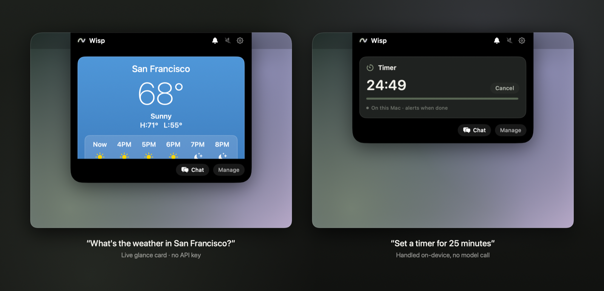
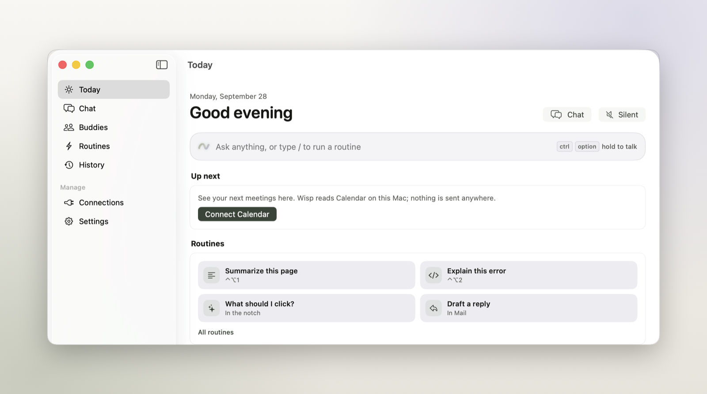
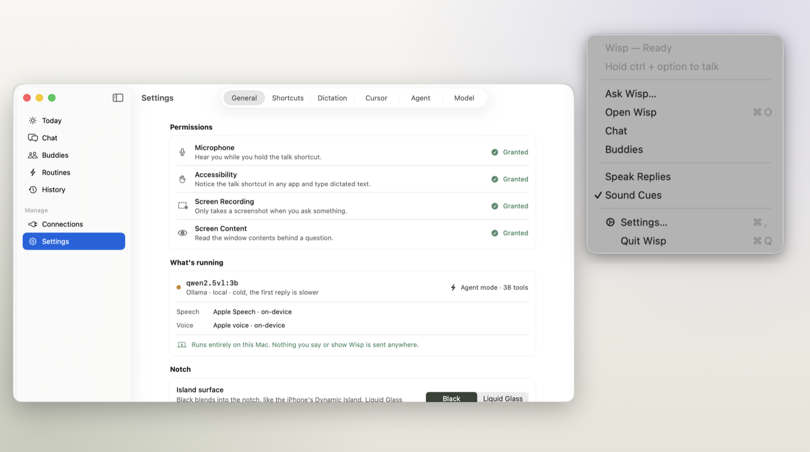
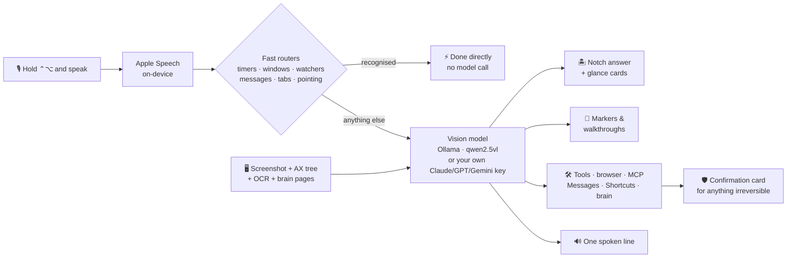
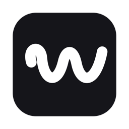

<p align="center">
  
</p>

<p align="center">
  <a href="#quick-start"></a>
  <a href="#quick-start"></a>
  <a href="#privacy"></a>
  <a href="#-acts-for-you"></a>
  <a href="LICENSE"></a>
</p>

<p align="center">
  <b>Hold <kbd>Control</kbd> + <kbd>Option</kbd>, say what you want, let go.</b><br>
  Wisp looks at your screen, answers in the notch, points at what it means —<br>
  and quietly does the busywork. No account. No API key. Nothing leaves your Mac.
</p>

<p align="center">
  <a href="#quick-start"><b>Quick start</b></a> ·
  <a href="#-try-saying">Try saying</a> ·
  <a href="#features">Features</a> ·
  <a href="#-the-brain">The brain</a> ·
  <a href="#-buddies">Buddies</a> ·
  <a href="#how-it-works">How it works</a> ·
  <a href="#privacy">Privacy</a>
</p>

<p align="center">
  
</p>

---

Wisp is a menu bar–only AI companion for macOS. It lives in the notch like a Dynamic
Island — invisible until you need it — listens when you hold a hotkey, sees what's on your
screen, and answers in a compact card. It can point at buttons, draw walkthroughs over your
apps, arrange your windows, watch your screen for you, drive your browser, text your
contacts, keep a wiki of what it learns about you, and run little scheduled agents in the
background.

**It all runs on your Mac by default:** a local vision model through Ollama, on-device
speech in and out, on-device OCR. Cloud models (Claude, GPT, Gemini) are strictly opt-in,
bring-your-own-key, and clearly labelled when they're on.

## 💬 Try saying

Hold <kbd>⌃</kbd><kbd>⌥</kbd> and talk, or tap it to type. Many of these never touch the model at all — Wisp
recognises them and just does it.

| You say | Wisp does | Model? |
|---|---|:---:|
| *"Where's the export button?"* | Drops a pulsing marker on it, on whichever monitor it's on | ⚡ none |
| *"Put Safari on the left and Xcode on the right"* | Tiles both windows over Accessibility | ⚡ none |
| *"Tell me when the build finishes"* | Watches the screen and pings you when "Succeeded" appears | ⚡ none |
| *"Text mom I'm running late"* | Finds Mom in Contacts, shows a Siri-style card, sends on your OK | ⚡ none |
| *"Set a timer for 10 minutes"* | A live countdown card in the notch | ⚡ none |
| *"Organize my tabs"* / *"Close duplicate tabs"* | Groups and tidies Chrome via the Wisp Tabs extension | ⚡ none |
| *"Add this page to my brain"* | Reads the front tab and files it into your local wiki | ⚡ none |
| *"Open github and search for swift markdown"* | Drives your real browser, in its own tab | 🧠 sometimes |
| *"Walk me through turning on FileVault"* | Numbered boxes and arrows drawn over System Settings | 🧠 yes |
| *"What's the weather in Lisbon?"* | An Apple Weather–style glance card | 🧠 yes |
| *"Every morning, summarise what's due today"* | Creates a buddy that does exactly that, on schedule | 🧠 yes |
| *"Run my Log Water shortcut"* | Runs an Apple Shortcut (after asking) | 🧠 yes |

## Screenshots

<p align="center">
  
  <br><sub><b>Today.</b> A live bento dashboard — ask bar, what Wisp did today, your buddies, your next meeting, the brain, one-click routines and recent answers.</sub>
</p>

<p align="center">
  
  <br><sub><b>Menu bar and settings.</b> A plain native menu for the quick stuff (including Pause Listening); Settings shows every permission, the model that's answering, and whether anything leaves your Mac.</sub>
</p>

## Features

<table>
<tr>
<td width="50%" valign="top">

### 🎙️ Talk to it
- **Push-to-talk** with <kbd>⌃</kbd><kbd>⌥</kbd> from any app — hold to talk, tap to type,
  hold + <kbd>⇧</kbd> to dictate into the focused field, double-tap <kbd>⌃</kbd> for hands-free.
- **Live transcript** in the notch, with an ambient lavender glow around your screen while it listens.
- **Custom dictionary and language** so names and jargon come out spelled right.
- **Voice or silent.** Every answer shows as text; in voice mode the model picks *one* short
  line worth saying instead of reading the whole reply.
- **Routines** — saved instructions on <kbd>⌃</kbd><kbd>⌥</kbd>+<kbd>1</kbd>…<kbd>9</kbd>.
- **Pause Listening** from the menu bar when you need quiet.

</td>
<td width="50%" valign="top">

### 👀 Sees your screen
- **Instant pointing.** "Where's X?" is matched against the app's Accessibility tree and
  on-device OCR — a marker lands in **~0.1s**, no vision model needed.
- **Walkthroughs.** Boxes, arrows and highlights over your live screen, auto-numbered into
  step-by-step guides.
- **Works on anything** — native apps via Accessibility, everything else (terminals, images,
  remote desktops) via Vision OCR.
- **Screen watchers.** "Tell me when it says Done" — Wisp polls OCR every 3s and notifies you.
  Up to 3 at once, no model calls.

</td>
</tr>
<tr>
<td width="50%" valign="top">

### 🏝️ Lives in the notch
- A **Dynamic Island** that wraps the physical notch, solid black like the real thing (Liquid
  Glass if you prefer), and disappears when idle.
- **Glance cards:** weather, calendar, reminders, timers, now playing, nearby places, and your
  own HTTPS sources.
- **Quick chat** that drops from the notch, with conversations and buddies in a sidebar.
- **Drop a file on the notch** to add it to your brain.
- A **morning briefing** with one-click suggestions, and **quiet mode** that stays silent while
  you're on a call.

</td>
<td width="50%" valign="top">

### 🤖 Acts for you
- **Agent mode** with tools, background tasks, and a notification when they finish.
- **Browser control** of your real Chrome or Safari, through the DOM, in **its own tab** — it
  never touches the one you're reading.
- **Window management:** halves, quarters, thirds, maximize, center, next display.
- **Messages & Contacts**, **Calendar & Reminders**, **Apple Shortcuts**.
- **Wisp Tabs** Chrome extension to group, dedupe and tidy tabs.
- **MCP client** with a built-in marketplace — any stdio or remote server, plus optional
  Composio for 500+ apps. Only the ~6 most relevant tools are shown per turn.

</td>
</tr>
</table>

### 🧠 The brain

Wisp keeps a **local wiki about you and your work** — `~/.wisp/brain/`, plain markdown, a valid
[Obsidian](https://obsidian.md) vault. Think Karpathy's "LLM wiki", but private.

- **Feeds itself** from what you choose: drop files, PDFs or web pages in, import notes
  (folders, Obsidian, Apple Notes), and digest ended conversations. An activity feed exists too
  — **off by default**, never screenshots, always summarised by the local model.
- **Every turn gets context** from up to four relevant pages (BM25 search, no embedding model to
  keep resident).
- **Nothing edits a page directly.** Every write is a validated proposal, sorted by trust —
  something read on the web can only append, never rewrite what you wrote — and **every change
  is one Undo** in Brain → Log.
- **Keeps itself tidy:** fixes broken links, merges duplicates, splits pages that grow too big.
- Browse it in the Wisp window as pages, a force-directed **graph**, an inbox, and a health check.

### 🫧 Buddies

Named little agents that each own one job — *"every morning, summarise my calendar"*, *"check
the release notes on Fridays"*. Each one has:

- **Its own thread**, so a run says what changed since last time and you can reply to it.
- **Its own memory**, notes it keeps for itself.
- **Its own model** — local, or a cloud model if you want it to run in parallel.
- **Its own tool allow-list** — give the news buddy the browser and nothing else.
- **Delegation** — a buddy can `ask_buddy` a peer for help, and crossing from local to cloud asks you first.
- A schedule (once / daily / weekly), unread dots, pins, and *notify when finished*.

### 🛡️ Safe by design

Anything that **sends, deletes, pays, posts, invites or runs a command asks first** — with a card
that shows exactly what will happen ("New Email · To · Subject · Body"), **even if you've turned
on auto-approve**. You can **edit the wording right on the card** before you allow it (never the
recipient, path or command), and the model is told what you changed. Password and payment fields
in the browser are refused outright.

## Fast by design

Small local models are slow at looking at pictures, so Wisp avoids asking them to. Measured on an
M3 Pro:

| | Typical approach | Wisp |
|---|---|---|
| Point at a button | Screenshot → vision model guesses pixels: **~4s**, often wrong | Accessibility + OCR match: **~0.1s** |
| Screenshot cost | 1280px ≈ 4,049 tokens | 896px ≈ **1,095 tokens**, reused when the screen hasn't changed |
| Simple browser task | Model plans every step | Deterministic planner first: **~1s**, no model |
| "Open a new tab", "tile my windows", "set a timer" | Hope the model calls the right tool | Recognised and run directly |
| Screen text | Ask the model to read it | Vision OCR in **~170ms**, started while you're still talking |

## How it works



The local model replies in plain text with small structured tags — `[POINT:…]`, `[BOX:…]`,
`[CARD:…]`, `[TOOL:…]`, `[SAY:…]` — that Wisp parses into markers, cards, tool calls and speech.
That keeps it working with small models that can't do native structured output; cloud providers
use their native tool calling instead.

## Quick start

**Requirements**

- Apple-silicon Mac on **macOS 26** or later (the notch uses Liquid Glass)
- 16 GB RAM recommended
- **Xcode 26**
- [Ollama](https://ollama.com/download)

**1. Pull the model**

```bash
ollama pull qwen2.5vl:3b
```

**2. Build and run**

```bash
git clone https://github.com/anaylab/wisp.git
cd wisp
open leanring-buddy.xcodeproj
```

Select the `leanring-buddy` scheme and press <kbd>⌘</kbd><kbd>R</kbd>. Wisp appears in the menu
bar (there's no Dock icon) and opens on **Today** with a checklist of the permissions it needs —
Microphone, Speech Recognition, Screen Recording and Accessibility. Grant them, then hold
<kbd>Control</kbd> + <kbd>Option</kbd> and talk.

> [!NOTE]
> The Xcode project and scheme keep their original `leanring-buddy` name, typo included.
> Only the app is called Wisp — please don't rename them.

**3. Install it (optional)**

```bash
./scripts/install.sh
```

This copies your Xcode build into `/Applications` without re-signing it, so your granted
permissions survive. Launch it with `open -a Wisp`.

> [!WARNING]
> Don't launch `Wisp.app/Contents/MacOS/Wisp` directly from a shell, and don't build with
> `xcodebuild` from the terminal. The first skips LaunchServices registration (speech
> recognition then crashes on the first push-to-talk); the second re-signs the app and
> resets its privacy permissions.

<details>
<summary><b>Optional extras</b> — better voices, Chrome tabs, MCP servers, cloud models</summary>

- **Better voices.** macOS ships compact voices that sound robotic. Enhanced and premium voices
  are a free download in **System Settings → Accessibility → Spoken Content → System Voice →
  Manage Voices**, and Wisp picks the best English one you have. Or run a local
  [Chatterbox](https://github.com/resemble-ai/chatterbox) server on port 8004 and set
  `VoiceTTSProvider` to `chatterbox`.
- **Chrome tab organizing.** Load [`chrome-extension/`](chrome-extension) unpacked in
  `chrome://extensions`. It talks to Wisp over a loopback-only WebSocket that only accepts that
  extension.
- **MCP servers.** Browse **Connections → Marketplace** in the Wisp window, or edit
  `~/.wisp/mcp.json` (Claude Desktop's format).
- **Cloud models.** **Settings → Model** → pick Claude (Opus 5.5 by default, with web search in
  agent mode), GPT or Gemini and paste your key. It's stored in your login Keychain, and Wisp
  labels clearly that screenshots now leave your Mac.

</details>

## Privacy

| | Default | Opt-in |
|---|---|---|
| Speech to text | Apple Speech, on-device | — |
| Answers & vision | Ollama on `localhost:11434` | Your own Anthropic, OpenAI or Gemini key |
| Voice | macOS voices, on-device | Chatterbox on `localhost:8004` |
| Screen reading | Vision OCR + Accessibility, on-device | — |
| Brain | Markdown on your disk | Activity feed (off by default, local model only) |
| Network traffic | `localhost` only, plus key-free weather/places lookups you can turn off | Only the provider or source you enable |
| API keys | none needed | stored in your login Keychain |
| Analytics | **none** | none |

Images are never written to disk in conversation history. Weather and places cards send only a
place name or search query — never a screenshot — and can be turned off in **Connections →
Sources**.

## Configuration

Almost everything lives in the Wisp window (menu bar icon → **Open Wisp**).

<details>
<summary><b>Info.plist defaults</b></summary>

Shipped defaults are in [`leanring-buddy/Info.plist`](leanring-buddy/Info.plist):

| Key | Default | Notes |
|---|---|---|
| `ChatProvider` | `ollama` | Default hint only — pick a provider in Settings → Model |
| `OllamaModel` | `qwen2.5vl:3b` | Bigger models point more accurately but answer slower |
| `OllamaBaseURL` | `http://localhost:11434` | |
| `VoiceTranscriptionProvider` | `apple` | |
| `VoiceTTSProvider` | `apple` | `chatterbox` to use a local Chatterbox server |
| `ChatterboxTTSServerURL` | `http://localhost:8004` | |
| `AgentModeEnabled` | `true` | Lets the model call tools; risky actions always ask |

</details>

<details>
<summary><b>Files Wisp reads and writes</b></summary>

| Path | What it's for |
|---|---|
| `~/.wisp/mcp.json` | MCP servers, in the same format Claude Desktop uses |
| `~/.wisp/sources.json` | Your own HTTPS endpoints for glance cards |
| `~/.wisp/skills/*.md` | Skills — only their names cost tokens until one is loaded |
| `~/.wisp/brain/` | The brain: an Obsidian-compatible markdown vault |
| `~/.wisp/memory.md` | Facts about you (used when the brain is off) |
| `~/Library/Application Support/Wisp/` | Conversation history, buddies and their threads/memory, routines, task history |

</details>

## Project layout

```text
leanring-buddy/           the app (Swift / SwiftUI + AppKit)
├── DesignSystem/         colour, type, spacing, motion tokens
├── Components/           Wisp mark, glass panels, bento tiles, icon system
├── DynamicIsland/        notch island, quick chat, morning briefing, quiet mode
├── WispWindow/           the Wisp window: Today, Chat, Buddies, Brain, Settings…
├── Brain/                the local wiki: pages, search, ingest, digests, lint
├── Buddies/              scheduled agents: threads, memory, models, tools, delegation
├── WindowManagement/     voice window layout
└── …                     providers, dictation, screen capture + OCR, agent loop, tools, MCP
leanring-buddyTests/      unit tests
Tests/                    standalone suites (plain swiftc, no Xcode build)
chrome-extension/         Wisp Tabs extension for Chrome
scripts/                  install and release scripts
docs/                     design docs and brand assets
```

[`AGENTS.md`](AGENTS.md) is the full architecture reference — every subsystem, key file and
convention. Start there before making changes.

## Development

```bash
# Unit tests: in Xcode, press ⌘U

# Logs from a running copy
log stream --predicate 'process == "Wisp"'
```

<details>
<summary><b>Standalone test suites</b> — plain <code>swiftc</code>, no Xcode build, no permission reset</summary>

```bash
./Tests/ModelProviderContract/run.sh     # provider layer
./Tests/AgentRuntimeIntegration/run.sh   # the agent loop, against the whole app
./Tests/HostileProviderAttack/run.sh     # an adversarial model vs the real agent loop
./Tests/FastPointing/run.sh              # "where is X" parsing and matching
./Tests/ScreenWatcher/run.sh             # screen-watch parsing and evaluation
./Tests/WindowManagement/run.sh          # window commands, app matching, frame math
./Tests/EditableConfirmation/run.sh      # which confirmation fields are editable
./Tests/BuddyThread/run.sh               # buddy threads and list rules
./Tests/BrainCore/run.sh                 # brain pages, edit planner, search
./Tests/BrainIngest/run.sh               # extraction, chunking, merging
./Tests/BrainDigest/run.sh               # conversation digests, notes import
./Tests/BrainActivity/run.sh             # activity exclusions and summaries
./Tests/BrainLint/run.sh                 # lint, merge, split
./Tests/BrainUI/run.sh                   # markdown rendering, graph layout
```

</details>

## Contributing

Issues and pull requests are welcome — see [CONTRIBUTING.md](CONTRIBUTING.md). Security issues
go through [SECURITY.md](SECURITY.md), not public issues.

## Credits

Wisp began as a fork of [Clicky](https://github.com/farzaa/clicky) by
[Farza](https://github.com/farzaa) and is MIT licensed accordingly. The original sends voice,
screenshots and conversations to cloud services through a Cloudflare Worker; Wisp replaces all of
that with models running on your Mac, and adds the notch island, the Wisp window, screen
annotation and fast pointing, the agent loop, browser control, window management, screen
watchers, the brain, buddies, glance cards and the MCP client.

Questions and bugs about Wisp belong here, not with the original author.

## License

MIT — see [LICENSE](LICENSE).

<p align="center">
  <br>
  <sub>Made to stay out of your way.</sub>
</p>
