<p align="center">
  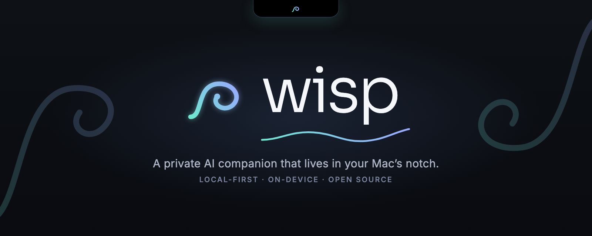
</p>

<p align="center">
  <a href="#quick-start"></a>
  <a href="#quick-start"></a>
  <a href="#privacy"></a>
  <a href="#models"></a>
  <a href="LICENSE"></a>
</p>

<h3 align="center">Hold <kbd>⌃</kbd> <kbd>⌥</kbd>. Say what you want. Let go.</h3>

<p align="center">
  Wisp is an AI companion for macOS that lives in your notch.<br>
  It sees your screen, points at what matters, and quietly does the busywork.<br>
  <b>No account. No API key. Nothing leaves your Mac.</b>
</p>

<p align="center">
  <a href="#quick-start"><b>Quick start</b></a> ·
  <a href="#what-it-does">What it does</a> ·
  <a href="#say-it">Say it</a> ·
  <a href="#models">Models</a> ·
  <a href="#how-it-works">How it works</a> ·
  <a href="#privacy">Privacy</a> ·
  <a href="#brand">Brand</a>
</p>

<p align="center">
  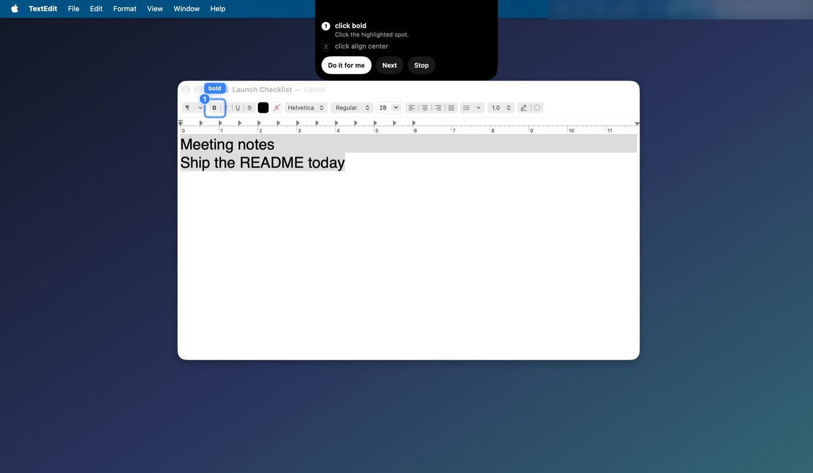
  <br><sub>Ask for help and Wisp walks you through it on your real screen, one boxed control at a time.</sub>
</p>

---

## Why Wisp

<table>
<tr>
<td width="33%" valign="top">

### 🔒 Private by default
Speech recognition, voice and screen reading run on your Mac's Neural Engine. The default model runs locally through Ollama. Cloud models are opt-in, bring-your-own-key, and labelled whenever they're on.

</td>
<td width="33%" valign="top">

### ⚡ Instant, not clever
Pointing at a button takes **~0.1s** with no vision model. Timers, window layouts, tab tidying and screen watchers are recognised and run directly, so the model only does the hard parts.

</td>
<td width="33%" valign="top">

### 🛡️ Asks before it acts
Anything that sends, deletes, pays, posts or runs a command shows a card with exactly what will happen, even with auto-approve on. You can edit the wording before you allow it.

</td>
</tr>
</table>

## Quick start

You need an Apple-silicon Mac on **macOS 26+**, **Xcode 26**, and [Ollama](https://ollama.com/download).

```bash
ollama pull qwen2.5vl:3b
git clone https://github.com/anaylab/wisp.git && cd wisp
open leanring-buddy.xcodeproj      # pick the leanring-buddy scheme, press ⌘R
```

Wisp appears in the menu bar (there is no Dock icon) and opens on **Today** with a checklist of the permissions it needs. Grant them, hold <kbd>Control</kbd> + <kbd>Option</kbd>, and talk. The first launch downloads the on-device speech models once; until they are ready, Apple's built-in engines stand in.

> [!NOTE]
> The Xcode project and scheme keep their original `leanring-buddy` name, typo included. Only the app is called Wisp. Please don't rename them.

<details>
<summary><b>Install it in /Applications, and what not to do</b></summary>

```bash
./scripts/install.sh     # copies your Xcode build to /Applications without re-signing, so permissions survive
open -a Wisp
```

Don't launch `Wisp.app/Contents/MacOS/Wisp` from a shell (speech recognition then crashes on the first push-to-talk), and don't build with `xcodebuild` from the terminal (it re-signs the app and resets its privacy permissions). Build in Xcode instead.

</details>

## What it does

### 🎯 Point at anything

Ask "where is the pi button?" and a pulsing, labelled marker lands on the exact control in about a tenth of a second. Wisp matches your words against the app's Accessibility tree and on-device OCR, so it works in native apps, terminals, images and remote desktops, on whichever monitor the control is on.

<p align="center">
  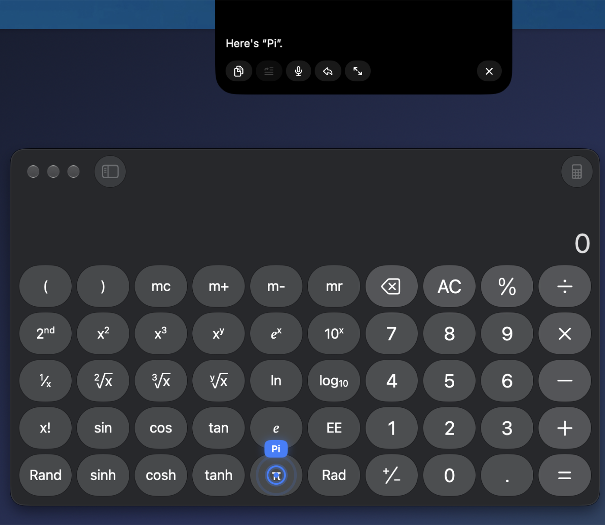
</p>

### 🧭 Guided walkthroughs

Ask how to do something and Wisp turns the answer into numbered steps over your live screen. It finds each next control again as the screen changes, ticks steps off as you click, and can click for you with **Do it for me**, but never anything irreversible.

<table>
<tr>
<td width="50%"></td>
<td width="50%">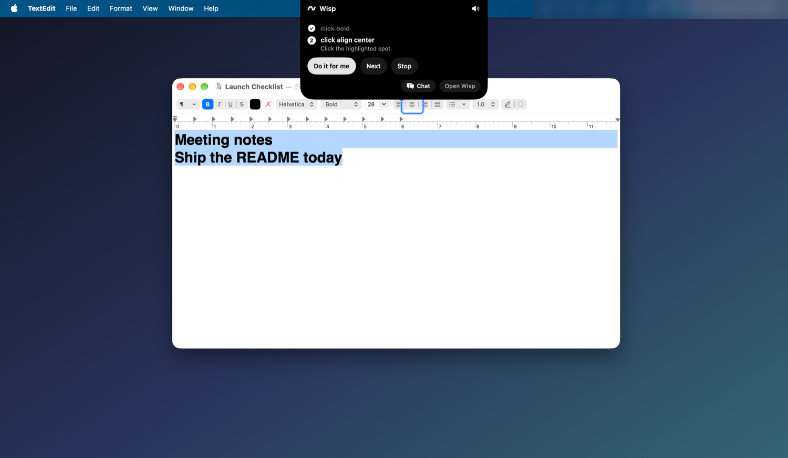</td>
</tr>
</table>

### ✍️ Shows its working on the page

Point Wisp at a problem and it writes handwritten working beside it, line by line, then lets you step through with **Next ›**. Save the finished page as a PNG with a Markdown summary.

<table>
<tr>
<td width="50%">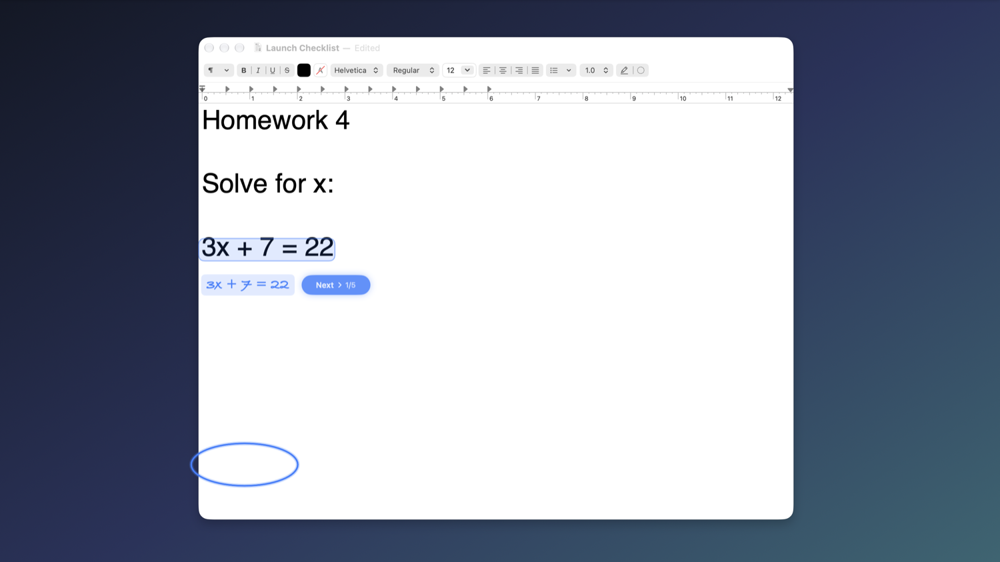</td>
<td width="50%">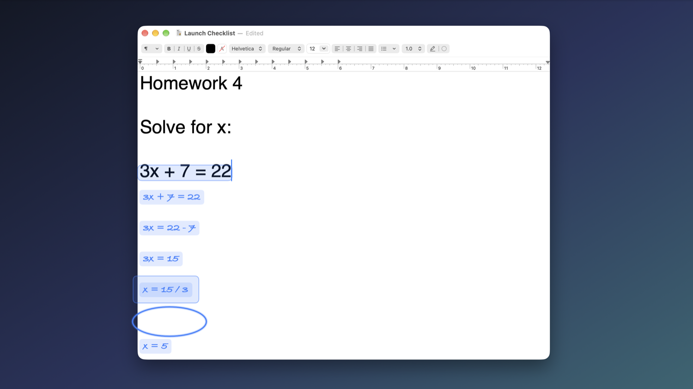</td>
</tr>
</table>

### ✂️ Ask about just a part

Drag a box around anything on screen, or just say "explain option C". Wisp highlights exactly what you chose, and the follow-ups ("why?", "next step") stay about that region.

<table>
<tr>
<td width="50%">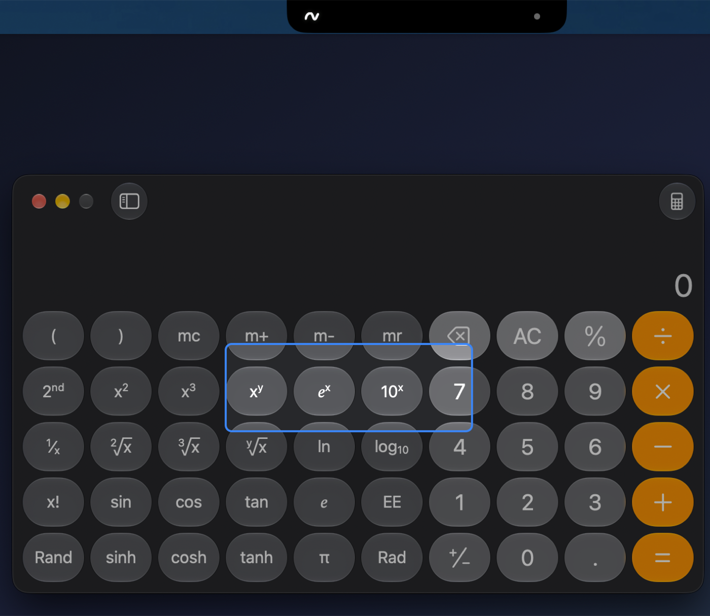</td>
<td width="50%">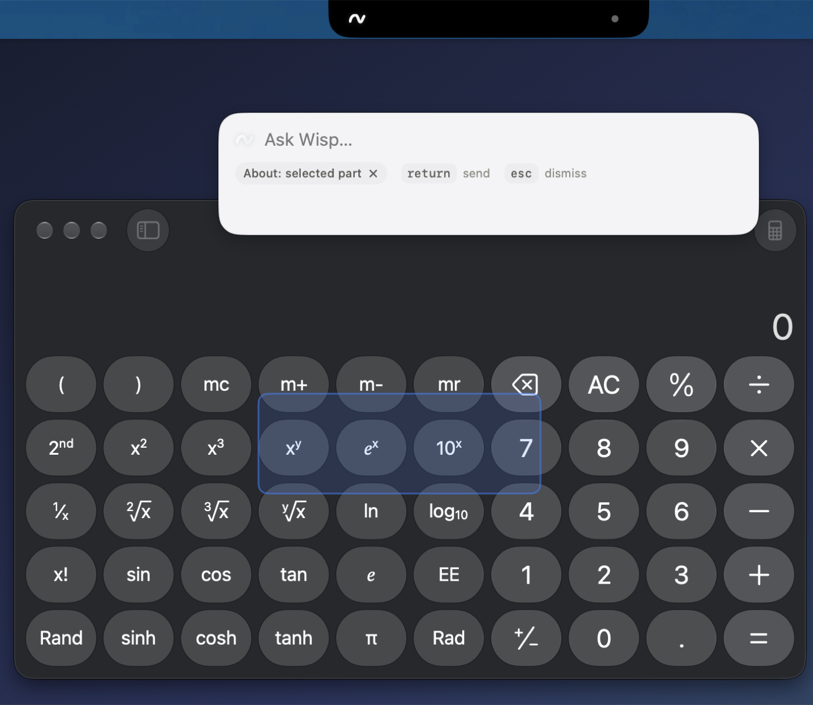</td>
</tr>
</table>

### 🪟 Rearrange your desk by voice

"Put Dictionary on the left and TextEdit on the right." Halves, quarters, thirds, maximize, center and next-display, over Accessibility, with no model call.

<p align="center">
  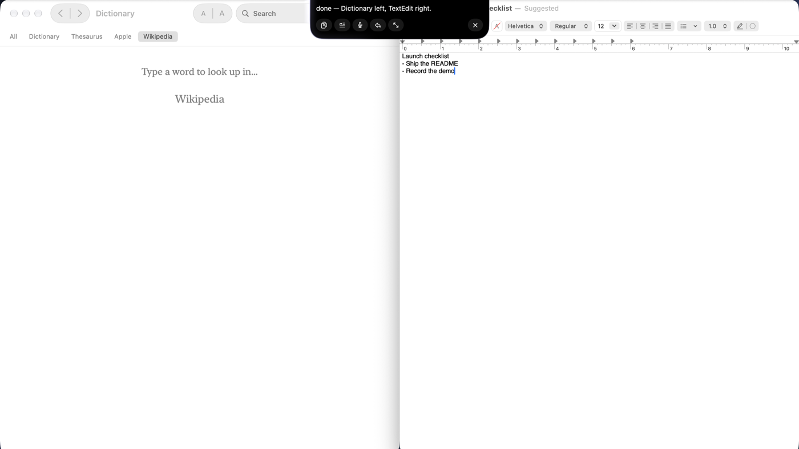
</p>

### 🌐 Drives your real browser

"Open Wikipedia and search for the Enigma machine." Wisp works through the page itself, in its own tab (never the one you are reading), then tells you where it landed. Password and payment fields are refused outright, and irreversible clicks always ask.

<p align="center">
  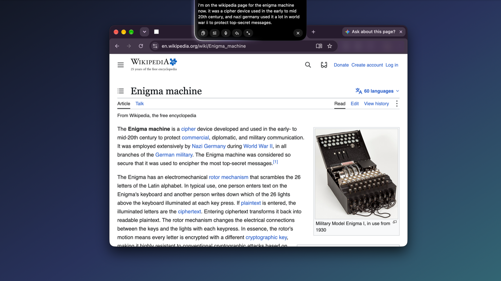
</p>

### ✉️ Drafts you review, actions you approve

An email request opens an editable draft instantly, and nothing leaves your Mac until you press **Send**. Anything riskier, like running a Shortcut, shows a card with exactly what will happen and a countdown.

<table>
<tr>
<td width="50%">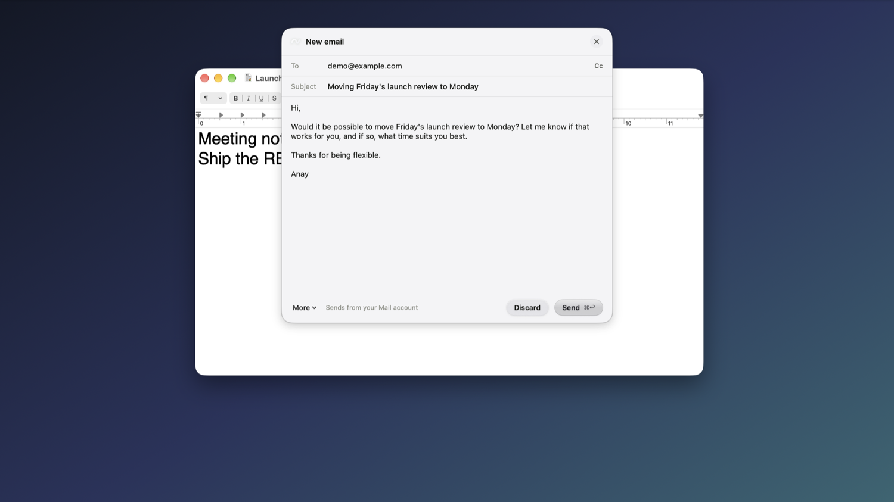</td>
<td width="50%">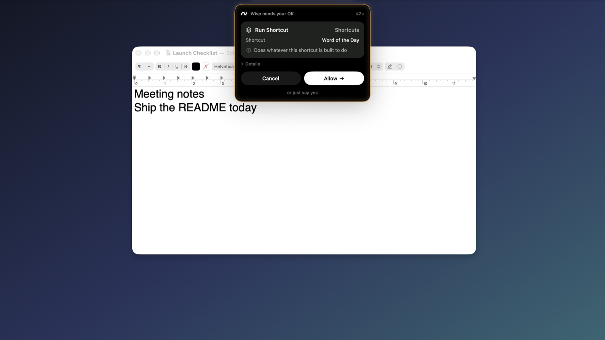</td>
</tr>
</table>

### 🫧 Buddies and automations that work while you're away

Buddies are named agents that each own one job, with their own thread, memory, model and tool allow-list. Automations follow **trigger → source → action → output → notify**, set up by saying it, picking a template, or saving an answer from History. Scheduled runs only get tools that never prompt, and pause themselves after three failures in a row.

<table>
<tr>
<td width="50%">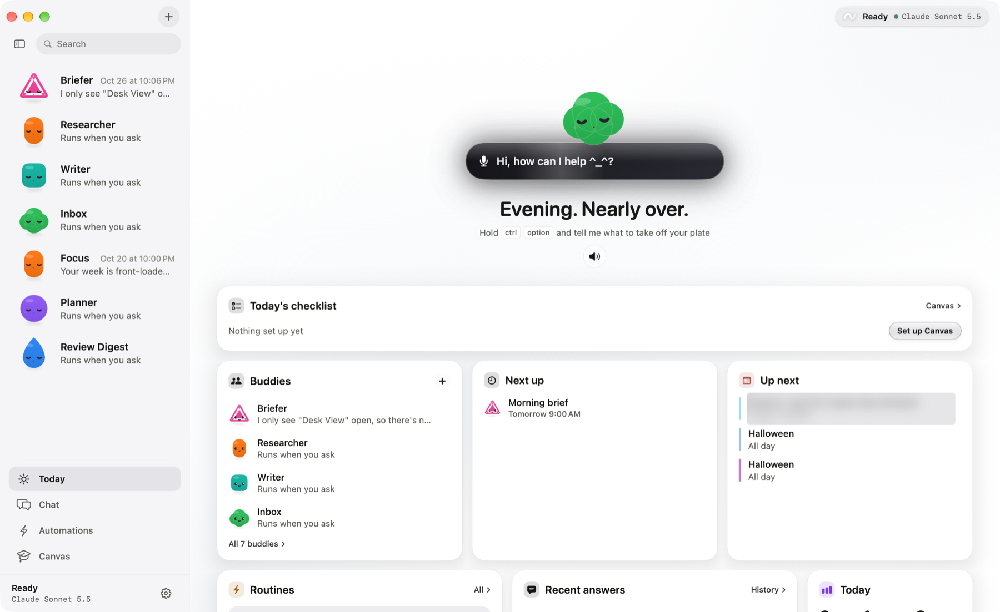</td>
<td width="50%">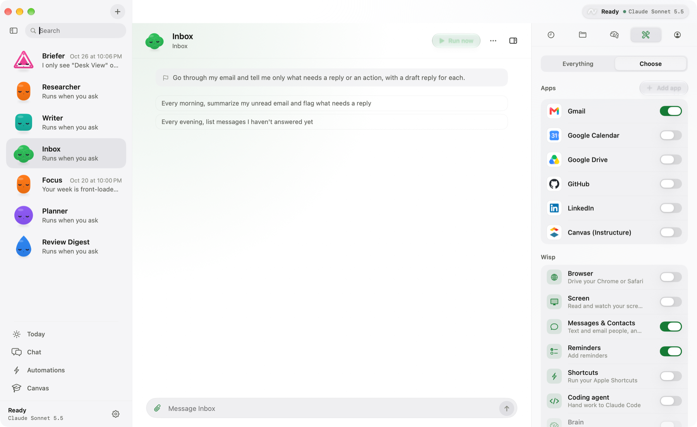</td>
</tr>
<tr>
<td width="50%">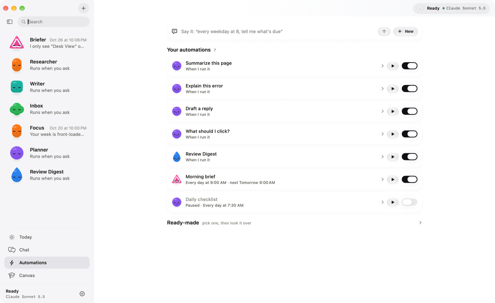</td>
<td width="50%">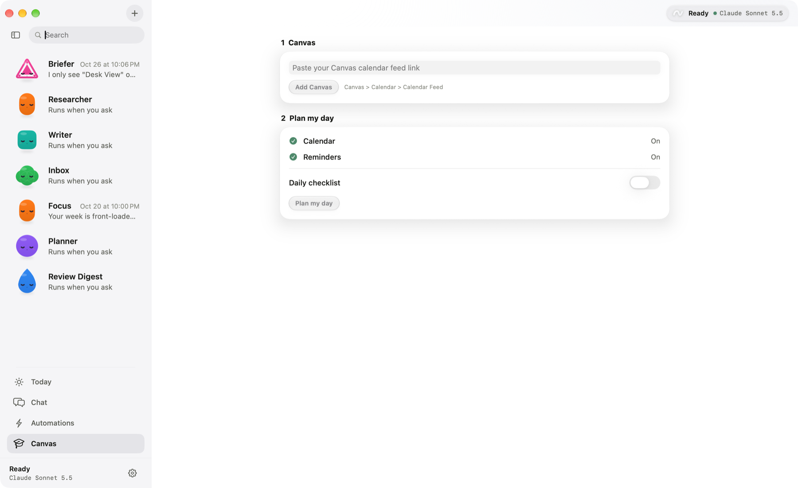</td>
</tr>
</table>

### 🧠 A private second brain

Wisp keeps a local wiki about you and your work in `~/.wisp/brain/`: plain markdown and a valid [Obsidian](https://obsidian.md) vault. Drop in files, PDFs and pages, import notes, and each turn gets context from the most relevant pages. Nothing edits a page directly; every write is a validated proposal, and **every change is one Undo**.

### 🔌 Plugs into everything

Install MCP servers from a built-in marketplace, connect 500+ apps through optional Composio, run Apple Shortcuts, and operate native Mac apps. Only the few tools relevant to each request reach the model.

<table>
<tr>
<td width="50%">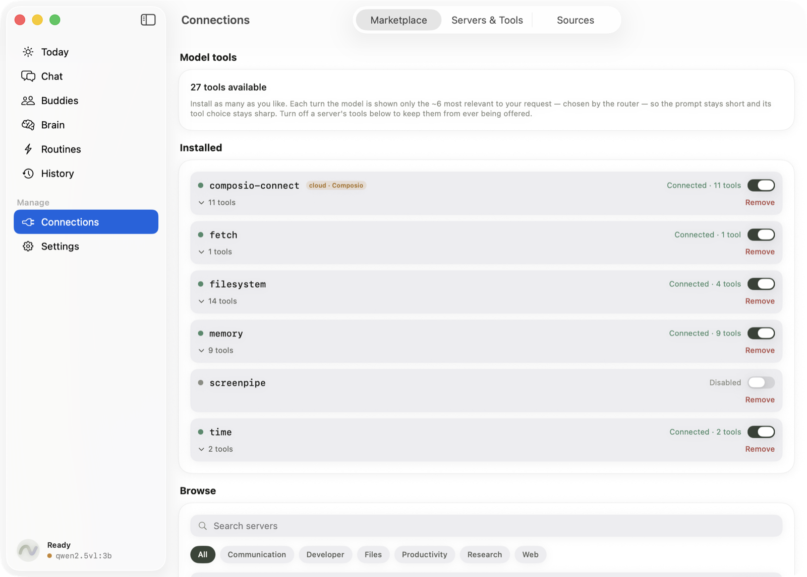</td>
<td width="50%">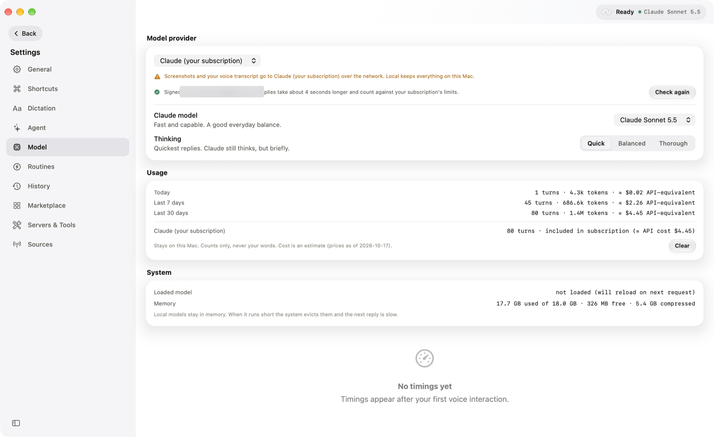</td>
</tr>
</table>

<details>
<summary><b>And more: the full feature list</b></summary>

- **Voice in and out.** Push-to-talk from any app: hold to talk, tap to type, hold + <kbd>⇧</kbd> to dictate into the focused field, double-tap <kbd>⌃</kbd> for hands-free. Parakeet transcribes 25 languages on-device with live partials and your own dictionary. Kokoro speaks one short line per reply.
- **Screen watchers.** "Tell me when it says Done": up to three at once, OCR every 3s, no model calls.
- **Glance cards.** Weather, calendar, reminders, timers, now playing, nearby places and your own HTTPS sources, right in the notch.
- **The notch island.** Wraps the physical notch, solid black like the real thing (Liquid Glass if you prefer), hover for the full panel, drop a file on it to add it to your brain.
- **Quick add.** "Remind me…", "every…", "when…" open an editable automation card instead of a model turn.
- **Routines.** Saved instructions on <kbd>⌃</kbd><kbd>⌥</kbd>+<kbd>1</kbd>…<kbd>9</kbd>, with `{blanks}` Wisp asks for first.
- **Learned shortcuts.** Save a finished turn and replay it later with no model call.
- **Canvas sync.** Paste your calendar feed once; Wisp keeps a "Wisp" calendar and a daily checklist in Reminders. Study blocks are only written after your approval.
- **Messages and Contacts.** "Text mom I'm running late" resolves Mom through Contacts and always asks before sending.
- **Chrome tabs.** The Wisp Tabs extension groups, dedupes, pins and mutes tabs on command.
- **Morning briefing and quiet mode.** One-click suggestions each morning, and silence while you are on a call.
- **Themes.** A theme gallery (Paper, Midnight, Aqua, Sage and more) in light and dark, contrast-checked, with Reduce Motion honoured.
- **Hardware aware.** Falls back to the built-in mic with the lid closed, and puts a muted reply on the clipboard instead of speaking into silence.
- **Usage log.** Token counts and estimated cost per provider, stored locally, content never kept.

</details>

## Say it

Hold <kbd>⌃</kbd><kbd>⌥</kbd> and talk, or tap it to type. The ⚡ rows never touch the model.

| You say | Wisp does | |
|---|---|:---:|
| *"Where's the export button?"* | Drops a pulsing marker on it | ⚡ |
| *"Put Safari on the left and Xcode on the right"* | Tiles both windows | ⚡ |
| *"Tell me when the build finishes"* | Watches the screen and pings you | ⚡ |
| *"Set a timer for 10 minutes"* | A live countdown card in the notch | ⚡ |
| *"Organize my tabs"* | Groups and tidies Chrome | ⚡ |
| *"Add this page to my brain"* | Files the front tab into your local wiki | ⚡ |
| *"Walk me through turning on FileVault"* | Numbered boxes over System Settings | 🧠 |
| *"Solve this"* | Handwritten working beside the problem | 🧠 |
| *"Draft an email to Sam about Friday"* | An editable draft, sent only when you press Send | 🧠 |
| *"Every morning, summarise what's due today"* | A buddy that does it on schedule | 🧠 |

## Models

Local is the default and the private path. Choose the brain in **Settings → Model**, and give any buddy its own.

| Provider | Runs | Needs |
|---|---|---|
| **Ollama** (default) | On your Mac | `qwen2.5vl:3b` |
| **Apple on-device** | On your Mac | Apple Intelligence |
| **Claude** (your key) | Anthropic | API key in Keychain |
| **Claude** (your subscription) | Your `claude` CLI | A signed-in `claude`, no API key |
| **GPT** / **Gemini** | OpenAI / Google | API key in Keychain |

## How it works

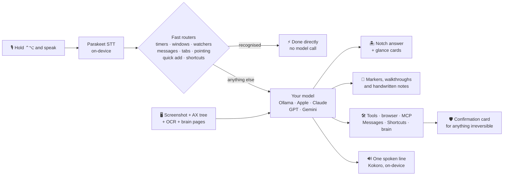

Small local models are slow at looking at pictures, so Wisp avoids asking them to. Measured on an M3 Pro:

| | Typical approach | Wisp |
|---|---|---|
| Point at a button | Screenshot → vision model guesses pixels: **~4s**, often wrong | Accessibility + OCR match: **~0.1s** |
| Screenshot cost | 1280px ≈ 4,049 tokens | 896px ≈ **1,095 tokens**, reused when the screen hasn't changed |
| Simple browser task | Model plans every step | Deterministic planner first: **~1s**, no model |
| Screen text | Ask the model to read it | Vision OCR in **~170ms**, started while you're still talking |
| Speech to text | Wait for the whole clip | Parakeet: **~120–300ms** from release to final transcript |
| Speaking a reply | Synthesise the whole answer | Kokoro: first audio in **~300ms**, sentence by sentence |

## Privacy

| | Default | Opt-in |
|---|---|---|
| Speech to text | Parakeet on the Neural Engine, on-device | — |
| Answers and vision | Ollama on `localhost:11434` | Apple on-device model, or your own Anthropic, OpenAI or Gemini key |
| Voice | Kokoro on the Neural Engine, on-device | A local Chatterbox server |
| Screen reading | Vision OCR + Accessibility, on-device | — |
| Brain | Markdown on your disk | Activity feed (off by default, local model only) |
| Network | `localhost`, a one-time speech-model download, and key-free weather/places lookups you can turn off | Only the provider, Canvas feed or source you enable |
| Secrets | none needed | Keys and feed URLs live in your login Keychain |
| Analytics | **none** | none |

Images are never written to disk in conversation history. Weather and places cards send only a place name or query, never a screenshot. The usage log keeps token counts and timings, never content.

<details>
<summary><b>Configuration, files and optional extras</b></summary>

Almost everything lives in the Wisp window. Shipped defaults are in [`leanring-buddy/Info.plist`](leanring-buddy/Info.plist):

| Key | Default | Notes |
|---|---|---|
| `ChatProvider` | `ollama` | Default hint only; pick a provider in Settings → Model |
| `OllamaModel` | `qwen2.5vl:3b` | Bigger models point better but answer slower |
| `VoiceTranscriptionProvider` | `fluidaudio` | Parakeet; `apple` for Apple Speech only |
| `VoiceTTSProvider` | `fluid` | Kokoro; `apple` for macOS voices, `chatterbox` for a local server |
| `AgentModeEnabled` | `true` | Lets the model call tools; risky actions always ask |

| Path | What it is for |
|---|---|
| `~/.wisp/mcp.json` | MCP servers, in Claude Desktop's format |
| `~/.wisp/sources.json` | Your own HTTPS endpoints for glance cards |
| `~/.wisp/skills/*.md` | Skills: only their names cost tokens until one is loaded |
| `~/.wisp/brain/` | The brain: an Obsidian-compatible markdown vault |
| `~/Library/Application Support/Wisp/` | History, buddies, automations, routines, learned shortcuts, usage log |

**Extras:** load [`chrome-extension/`](chrome-extension) unpacked for tab organizing (it talks to Wisp over a loopback-only WebSocket that accepts only that extension); install [cua-driver](https://github.com/trycua/cua) to operate native apps (every click still asks); paste a Canvas feed URL on the Canvas page (kept only in your Keychain).

</details>

## Development

[`AGENTS.md`](AGENTS.md) is the full architecture reference: every subsystem, key file and convention. Start there before changing anything.

```bash
# Unit tests: in Xcode, press ⌘U
log stream --predicate 'process == "Wisp"'     # logs from a running copy
./Tests/FastPointing/run.sh                    # standalone suites: plain swiftc, no Xcode, no permission reset
```

<details>
<summary><b>Project layout and test suites</b></summary>

```text
leanring-buddy/           the app (Swift / SwiftUI + AppKit, ~350 files)
├── DesignSystem/         colour, type, spacing, motion tokens and themes
├── Components/           Wisp mark, glass panels, bento tiles, icon system
├── DynamicIsland/        notch island, quick chat, morning briefing, quiet mode
├── WispWindow/           the Wisp window: Today, Chat, Buddies, Automations, Canvas, Settings
├── Brain/                the local wiki: pages, search, ingest, digests, lint
├── Buddies/              agents: threads, memory, models, tools, delegation, characters
├── Automations/          trigger → source → action → output engine
├── Jobs/                 Canvas calendar sync and the daily checklist
├── LearnedShortcuts/     save and replay a finished turn with no model
├── WindowManagement/     voice window layout
├── Email/                editable drafts and Mail sending
└── …                     providers, dictation, screen capture + OCR, agent loop, tools, MCP
Tests/                    36 standalone suites
chrome-extension/         Wisp Tabs extension for Chrome
scripts/                  install and release scripts
docs/                     design docs and brand assets
```

```bash
./Tests/ModelProviderContract/run.sh     # provider layer
./Tests/AgentRuntimeIntegration/run.sh   # the agent loop, against the whole app
./Tests/BrowserReplyGrounding/run.sh     # browser task replies match the page
./Tests/FastPointing/run.sh              # "where is X" parsing and matching
./Tests/GuidedWalkthrough/run.sh         # walkthrough stepping and click matching
./Tests/WindowManagement/run.sh          # window commands, app matching, frame math
./Tests/AutomationEngine/run.sh          # unattended safety and approvals
./Tests/BrainCore/run.sh                 # brain pages, edit planner, search
```

The full list is in [`AGENTS.md`](AGENTS.md).

</details>

## Brand

The mark is a curling wisp that ends in an orb: a thought, caught mid-air. The wordmark is lowercase Sora Light with a hand-drawn swish.

<table>
<tr>
<td align="center" width="50%" bgcolor="#FFFFFF">
  <picture>
    <source media="(prefers-color-scheme: dark)" srcset="docs/assets/brand/lockup-dark.png">
    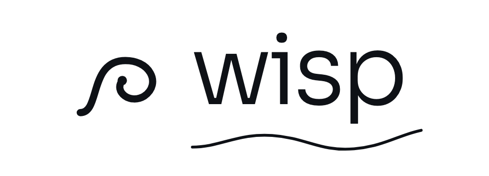
  </picture>
</td>
<td align="center" width="25%">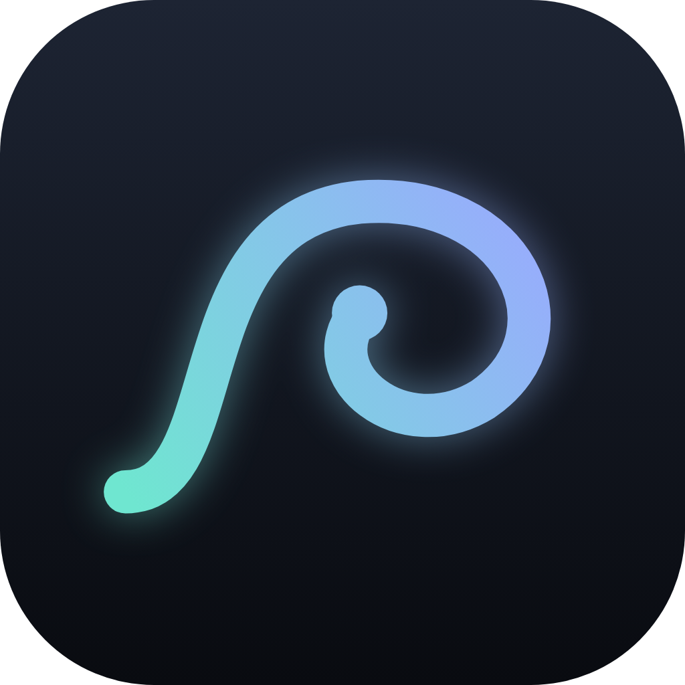</td>
<td align="center" width="25%">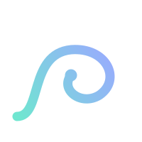</td>
</tr>
</table>

| Colour | Hex | Use |
|---|---|---|
| **Ink** | `#0E1116` | Text, mark on light, dark surfaces |
| **Mint** | `#6FE6D0` | Start of the signature gradient |
| **Periwinkle** | `#9AA9FF` | End of the signature gradient |

Assets live in [`docs/assets/brand/`](docs/assets/brand).

## Contributing

Issues and pull requests are welcome; see [CONTRIBUTING.md](CONTRIBUTING.md). Security issues go through [SECURITY.md](SECURITY.md), not public issues.

## License

MIT. See [LICENSE](LICENSE) for the copyright notices.

<p align="center">
  <br>
  <sub>Made to stay out of your way.</sub>
</p>
