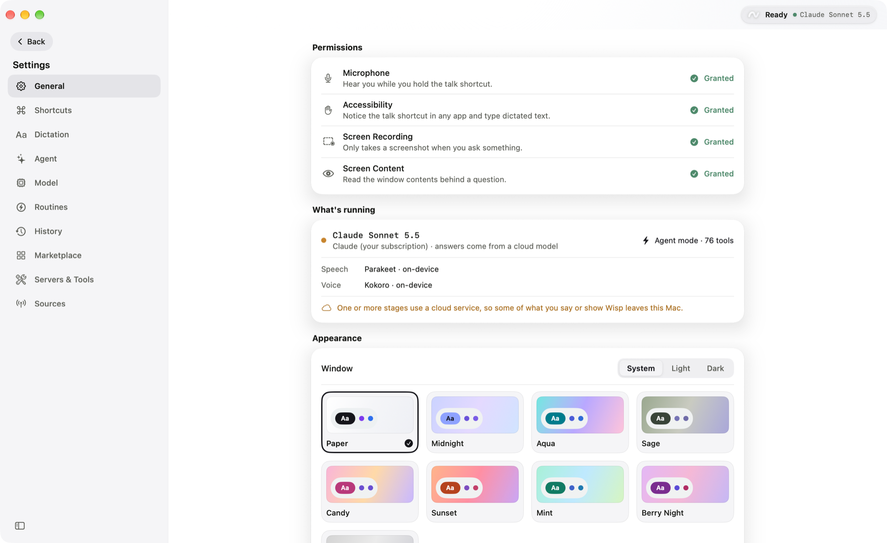
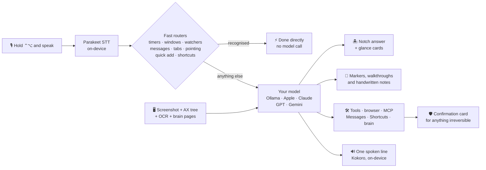

<p align="center">
  
</p>

<p align="center">
  <a href="#quick-start"></a>
  <a href="#quick-start"></a>
  <a href="#privacy"></a>
  <a href="#acts-for-you"></a>
  <a href="LICENSE"></a>
</p>

<h3 align="center">Hold <kbd>⌃</kbd> <kbd>⌥</kbd>, say what you want, let go.</h3>

<p align="center">
  Wisp looks at your screen, answers in the notch, points at what it means,<br>
  and quietly does the busywork. No account. No API key. Nothing leaves your Mac.
</p>

<p align="center">
  <a href="#quick-start"><b>Quick start</b></a> ·
  <a href="#try-saying">Try saying</a> ·
  <a href="#tour">Tour</a> ·
  <a href="#everything-wisp-does">Everything Wisp does</a> ·
  <a href="#models">Models</a> ·
  <a href="#how-it-works">How it works</a> ·
  <a href="#privacy">Privacy</a> ·
  <a href="#brand">Brand</a>
</p>

<p align="center">
  
</p>

---

## What is Wisp?

Wisp is a **menu bar–only AI companion for macOS**. It lives in the notch like a Dynamic Island,
invisible until you need it. Hold a hotkey and it listens, sees what is on your screen, and answers
in a compact card. From there it grows into a small operating layer for your Mac:

- **Sees and points.** Marks the button you are looking for in ~0.1s, draws step-by-step
  walkthroughs over your apps, and writes handwritten working beside a problem.
- **Does things.** Arranges windows, drives your browser in its own tab, texts your contacts,
  drafts emails, runs Shortcuts, and operates native apps.
- **Remembers.** Keeps a private, Obsidian-compatible wiki of what it learns about you.
- **Works while you are away.** Named buddies and automations run on a schedule or when something
  happens, quietly, and only interrupt you when it matters.

**It all runs on your Mac by default:** a local vision model through Ollama, on-device speech
recognition (Parakeet) and speech synthesis (Kokoro) on the Neural Engine, and on-device OCR. Cloud
models are strictly opt-in, bring-your-own-key, and labelled whenever they are on.

<table>
<tr>
<td align="center" width="20%"><h3>~0.1s</h3><sub>to point at a button, with no vision model</sub></td>
<td align="center" width="20%"><h3>0</h3><sub>accounts, API keys or analytics needed</sub></td>
<td align="center" width="20%"><h3>25</h3><sub>languages transcribed on-device</sub></td>
<td align="center" width="20%"><h3>500+</h3><sub>apps reachable through MCP and Composio</sub></td>
<td align="center" width="20%"><h3>100k+</h3><sub>lines of Swift, 35 standalone test suites</sub></td>
</tr>
</table>

## Try saying

Hold <kbd>⌃</kbd><kbd>⌥</kbd> and talk, or tap it to type. Many of these never touch the model at all:
Wisp recognises them and just does it.

| You say | Wisp does | Model? |
|---|---|:---:|
| *"Where's the export button?"* | Drops a pulsing marker on it, on whichever monitor it is on | ⚡ none |
| *"Put Safari on the left and Xcode on the right"* | Tiles both windows over Accessibility | ⚡ none |
| *"Tell me when the build finishes"* | Watches the screen and pings you when "Succeeded" appears | ⚡ none |
| *"Text mom I'm running late"* | Finds Mom in Contacts, shows a Siri-style card, sends on your OK | ⚡ none |
| *"Set a timer for 10 minutes"* | A live countdown card in the notch | ⚡ none |
| *"Remind me to call the dentist tomorrow at 9"* | Opens an editable automation card instead of a model turn | ⚡ none |
| *"Organize my tabs"* / *"Close duplicate tabs"* | Groups and tidies Chrome via the Wisp Tabs extension | ⚡ none |
| *"Add this page to my brain"* | Reads the front tab and files it into your local wiki | ⚡ none |
| *"Explain the third answer"* / *"What does step 2 mean?"* | Selects that part of the screen and explains just that | 🧠 yes |
| *"Draft an email to Sam about moving Friday's meeting"* | Opens an editable draft; nothing sends until you press Send | 🧠 one call |
| *"Walk me through turning on FileVault"* | Numbered boxes and arrows drawn over System Settings, one step at a time | 🧠 yes |
| *"Solve this"* (on a math problem) | Handwritten working beside each line, the answer circled | 🧠 yes |
| *"Open github and search for swift markdown"* | Drives your real browser, in its own tab | 🧠 sometimes |
| *"What's the weather in Lisbon?"* | An Apple Weather–style glance card | 🧠 yes |
| *"Every morning, summarise what's due today"* | A buddy that does exactly that, on schedule | 🧠 yes |
| *"Run my Log Water shortcut"* | Runs an Apple Shortcut, after asking | 🧠 yes |

## See it in action

These are real captures of Wisp running, not mockups. The first four needed no model at all: Wisp
recognised the request and did it directly.

<table>
<tr>
<td width="33%" align="center" valign="top">
  
  <br><sub><b>"Where is the pi button?"</b> A labelled marker lands on the exact control in about a tenth of a second, matched from the Accessibility tree. The notch confirms what it found.</sub>
</td>
<td width="33%" align="center" valign="top">
  
  <br><sub><b>Ask About a Part.</b> Drag a box around anything on screen, or just say "explain option C". Wisp highlights exactly what you chose.</sub>
</td>
<td width="33%" align="center" valign="top">
  
  <br><sub><b>Follow-ups stay on it.</b> The composer carries an "About: selected part" chip, so "why?" and "next step" are about that region.</sub>
</td>
</tr>
</table>

<p align="center">
  
  <br><sub><b>"Put Dictionary on the left and TextEdit on the right."</b> Two windows tiled over Accessibility in an instant, no model call, and a one-line confirmation in the notch.</sub>
</p>

### When the model steps in

<p align="center">
  
  <br><sub><b>"Walk me through making this bold and centered."</b> The notch keeps a numbered checklist. Wisp boxes the control for the current step, finds the next one again as the screen changes, and advances when you click it. <b>Do it for me</b> clicks it for you (never anything irreversible).</sub>
</p>

<table>
<tr>
<td width="50%" align="center" valign="top">
  
  <br><sub><b>"Solve this, step by step, on the page."</b> The problem is highlighted and the first line of working is handwritten beside it, with a <b>Next ›</b> pill.</sub>
</td>
<td width="50%" align="center" valign="top">
  
  <br><sub><b>Click through, or press <kbd>⌃⌥→</kbd>.</b> Each click reveals the next line of working, down to x = 5. <b>Save worked solution</b> exports the finished page as a PNG.</sub>
</td>
</tr>
</table>

## Tour

<p align="center">
  
  <br><sub><b>Today.</b> Your buddies on the left, and a calm bento dashboard on the right: ask pill, today's checklist, next automations, upcoming events, routines and recent answers.</sub>
</p>

<table>
<tr>
<td width="50%" align="center" valign="top">
  
  <br><sub><b>Buddies.</b> Every buddy has its own character, thread and a Tools panel: which connected apps and which Wisp abilities it may use.</sub>
</td>
<td width="50%" align="center" valign="top">
  
  <br><sub><b>Automations.</b> Say it in a sentence, or start from a ready-made one. Run, pause or inspect each from the list.</sub>
</td>
</tr>
<tr>
<td width="50%" align="center" valign="top">
  
  <br><sub><b>Canvas.</b> Paste your calendar feed once; Wisp plans the day into Calendar and Reminders.</sub>
</td>
<td width="50%" align="center" valign="top">
  
  <br><sub><b>Marketplace.</b> Connect Gmail, Calendar, Drive, GitHub, Slack, Notion and more, with real logos and one-click disconnect.</sub>
</td>
</tr>
<tr>
<td width="50%" align="center" valign="top">
  
  <br><sub><b>Model.</b> Pick the brain, set how hard it thinks, and see local usage and memory. Anything that leaves your Mac is flagged.</sub>
</td>
<td width="50%" align="center" valign="top">
  
  <br><sub><b>Settings.</b> Permissions, what is running (speech and voice on-device), and a gallery of themes.</sub>
</td>
</tr>
</table>

<p align="center">
  
  <br><sub><b>The notch.</b> Where Wisp is used: answers, glance cards, approvals and quick chat.</sub>
</p>

## Everything Wisp does

<table>
<tr>
<td width="50%" valign="top">

### 🎙️ Talk to it
- **Push-to-talk** with <kbd>⌃</kbd><kbd>⌥</kbd> from any app: hold to talk, tap to type,
  hold + <kbd>⇧</kbd> to dictate into the focused field, double-tap <kbd>⌃</kbd> for hands-free.
  A brief badge names which of the four you fired, and a lavender glow frames your screen while it listens.
- **On-device speech.** Parakeet on the Neural Engine transcribes 25 languages with live partials,
  boosted by your own dictionary. Apple Speech is the automatic fallback.
- **Voice or silent.** Every answer shows as text; in voice mode the model picks *one* short
  line worth saying, spoken by on-device Kokoro.
- **Quick add.** "Remind me…", "every…", "when…" open an editable automation card, no model turn.
- **Routines** are saved instructions on <kbd>⌃</kbd><kbd>⌥</kbd>+<kbd>1</kbd>…<kbd>9</kbd>, with
  `{blanks}` Wisp asks for first.
- **Hardware-aware.** Falls back to the built-in mic with the lid closed or when a mic goes silent,
  and puts a muted reply on the clipboard instead of speaking into silence.

</td>
<td width="50%" valign="top">

### 👀 Sees your screen
- **Instant pointing.** "Where's X?" is matched against the Accessibility tree and on-device
  OCR; a marker lands in **~0.1s**, with a marker on each match when a label appears twice.
- **Guided walkthroughs.** Boxes and arrows stepped one at a time. Wisp finds each next control
  again on the live screen, advances when you click it, and can click it *for* you (never
  anything irreversible).
- **Teaches on the page.** Circles an answer, writes handwritten working beside a problem, and
  steps through it with a **Next ›** pill or <kbd>⌃⌥→</kbd>. **Save worked solution** exports
  the annotated screen as a PNG plus Markdown notes.
- **Ask about a part.** Drag to select a region, click a note Wisp drew, or just say
  *"explain option C"*; follow-ups stay about that part.
- **Screen watchers.** "Tell me when it says Done": up to 3 at once, OCR every 3s, no model calls.
- **Works on anything:** native apps via Accessibility, everything else (terminals, images,
  remote desktops) via Vision OCR.

</td>
</tr>
<tr>
<td width="50%" valign="top">

### 🏝️ Lives in the notch
- A **Dynamic Island** that wraps the physical notch, solid black like the real thing (Liquid
  Glass if you prefer), and disappears when idle. Hover for the full panel.
- **Glance cards:** weather, calendar, reminders, timers, now playing, nearby places, and your
  own HTTPS sources.
- **Quick chat** that drops from the notch, with conversations and buddies in a sidebar.
- **A working buddy** sits in the notch's flank while its run is in progress.
- **Drop a file on the notch** to add it to your brain.
- **Sound cues and haptics** for listening, thinking, replying and approvals.
- **Morning briefing** with one-click suggestions, plus **quiet mode** that stays silent while
  you are on a call or the camera is on.

</td>
<td width="50%" valign="top" id="acts-for-you">

### 🤖 Acts for you
- **Agent mode** with tools, background tasks, and a notification when they finish.
- **Browser control** of your real Chrome or Safari, through the DOM, in **its own tab**. A
  three-tier planner keeps simple tasks model-free; with a cloud model, a long-horizon agent
  handles forms and multi-page jobs.
- **Native-app control** through [cua-driver](https://github.com/trycua/cua): click, type and
  pick menus in any Mac app, each action behind a confirmation card, checked after it runs.
- **Window management:** halves, quarters, thirds, maximize, center, next display.
- **Messages & Contacts**, **email drafts** (you press Send), **Calendar & Reminders**,
  **Apple Shortcuts**, and music control.
- **Learned shortcuts:** save a finished turn and replay it later with no model call.
- **Wisp Tabs** Chrome extension to group, dedupe, pin and mute tabs.
- **MCP client** with a built-in marketplace: any stdio or remote server, plus optional
  Composio for 500+ apps. Only the few most relevant tools are shown per turn.

</td>
</tr>
<tr>
<td width="50%" valign="top">

### 🫧 Buddies
Named agents that each own one job, listed in the window's sidebar like contacts.

- **Living characters**, each its own shape (triangle, pill, cube, cloud, drop…), that breathe,
  blink, follow your pointer and show a mood: working, happy, sleepy, oops, waiting for your OK.
- **Their own thread, memory, model and tool allow-list.** Give the news buddy the browser and
  nothing else, limit which connected apps it may use, or run one on a cloud model in parallel.
- **Personalities** (Coach, Chill, Hype, Deadpan, Teacher) and **specialties** (Coder, Inbox,
  Planner, Writer, Researcher…) with sensible starter jobs and apps.
- **Delegation.** A buddy can ask a peer for help in the peer's own thread; crossing from
  local to cloud asks you first. No chains.
- **Files.** Drop documents and pictures into a buddy's thread; it can read them later.
- Unread dots, pins, *notify when finished*, and `.wisp` files to share a buddy's setup.

</td>
<td width="50%" valign="top">

### ⏱️ Automations and Canvas
One model: **trigger → source → action → output → notify**.

- **Triggers:** a schedule, a new Canvas item, a meeting about to start, text appearing on
  screen, a file dropped in a folder, or a button.
- **Three ways to set one up:** say it, pick a template (Morning brief, Meeting prep, Weekly
  review, Screen watch…), or save an answer from History.
- **Unattended means safe.** Scheduled runs only get tools that never prompt, never auto-approve,
  and pause themselves after three failures in a row.
- **Canvas calendar sync.** Paste your `.ics` feed once; Wisp keeps a "Wisp" calendar and a daily
  checklist in Reminders. Study blocks are proposed, and written only after your approval.
  No model call on the sync path.
- Waits for wake and the network before running anything in the background.

</td>
</tr>
<tr>
<td width="50%" valign="top">

### 🧠 The brain
A **local wiki about you and your work**, in `~/.wisp/brain/`: plain markdown and a valid
[Obsidian](https://obsidian.md) vault. Think Karpathy's "LLM wiki", but private.

- **Feeds itself** from what you choose: drop files, PDFs or web pages in, import notes (folders,
  Obsidian, Apple Notes), and digest ended conversations. An activity feed exists too, **off by
  default**, never screenshots, always summarised by the local model.
- **Every turn gets context** from up to four relevant pages (BM25, no embedding model to keep
  resident).
- **Nothing edits a page directly.** Every write is a validated proposal sorted by trust, and
  **every change is one Undo** in Brain → Log.
- **Keeps itself tidy:** fixes broken links, merges duplicates, splits oversized pages.
- Browse it as pages, a force-directed **graph**, an inbox and a health check.

</td>
<td width="50%" valign="top">

### 🎨 Made to feel native
- **A theme gallery** (Paper, Midnight, Aqua, Sage and more) in light and dark, contrast-checked.
- **Liquid Glass** surfaces on macOS 26, one lit-edge button style, a bespoke single-stroke icon set.
- **A sidebar window.** Your buddies sit on top, then **Today**, **Chat**, **Automations** and **Canvas**;
  everything else (shortcuts, dictation, agent, model, routines, history, marketplace, servers, sources)
  lives under one **Settings** gear, and an **Advanced features** switch adds Brain.
- **First-run setup** in four skippable steps; nothing is switched on until you tap it.
- **Playful, but optional.** Squish, bounce and bursts yield to Reduce Motion.
- **Usage log** with token counts and estimated cost per provider, stored locally, content never kept.

</td>
</tr>
</table>

### 🛡️ Safe by design

Anything that **sends, deletes, pays, posts, invites or runs a command asks first**, with a card
that shows exactly what will happen ("New Email · To · Subject · Body"), **even if you have turned
on auto-approve**. You can **edit the wording right on the card** before you allow it (never the
recipient, path or command), and the model is told what you changed. Password and payment fields
in the browser are refused outright. Per-buddy tool limits are enforced at call time, not just
hidden, and anything imported from a file is inert until you review it.

## Models

Local is the default and the private path. You choose the brain behind Wisp in **Settings → Model**.

| Provider | Runs | Needs | Notes |
|---|---|---|---|
| **Ollama** (default) | On your Mac | Ollama, `qwen2.5vl:3b` | Sees screenshots; bigger models point better but answer slower |
| **Apple on-device** | On your Mac | Apple Intelligence | System language model through FoundationModels; no server or download |
| **Claude** (your key) | Anthropic | API key in Keychain | Opus 5.5 by default, adaptive thinking, optional web search |
| **Claude** (your subscription) | Your `claude` CLI | Signed-in `claude` | No API key; Wisp never touches the CLI's credentials |
| **GPT** | OpenAI | API key in Keychain | Native tool calling |
| **Gemini** | Google | API key in Keychain | Native tool calling |

Each buddy can use its own model, and a buddy on a cloud model is never given your private brain
tools. Anything that sends a screenshot off your Mac is labelled as such.

## Fast by design

Small local models are slow at looking at pictures, so Wisp avoids asking them to. Measured on an
M3 Pro:

| | Typical approach | Wisp |
|---|---|---|
| Point at a button | Screenshot → vision model guesses pixels: **~4s**, often wrong | Accessibility + OCR match: **~0.1s** |
| Screenshot cost | 1280px ≈ 4,049 tokens | 896px ≈ **1,095 tokens**, reused when the screen has not changed |
| Simple browser task | Model plans every step | Deterministic planner first: **~1s**, no model |
| "Open a new tab", "tile my windows", "set a timer" | Hope the model calls the right tool | Recognised and run directly |
| Screen text | Ask the model to read it | Vision OCR in **~170ms**, started while you are still talking |
| Speech to text | Wait for the whole clip | Parakeet: **~120–300ms** from release to final transcript |
| Speaking a reply | Synthesise the whole answer | Kokoro: first audio in **~300ms**, sentence by sentence |

## How it works



The local model replies in plain text with small structured tags (`[POINT:…]`, `[BOX:…]`,
`[CIRCLE:…]`, `[NOTE:…]`, `[CARD:…]`, `[TOOL:…]`, `[SAY:…]`) that Wisp parses into markers, cards,
tool calls and speech. That keeps it working with small models that cannot do native structured
output; cloud providers use their native tool calling instead.

## Quick start

**Requirements**

- Apple-silicon Mac on **macOS 26** or later (the notch uses Liquid Glass)
- 16 GB RAM recommended
- **Xcode 26**
- [Ollama](https://ollama.com/download)

**1. Pull the model**

```bash
ollama pull qwen2.5vl:3b
```

**2. Build and run**

```bash
git clone https://github.com/anaylab/wisp.git
cd wisp
open leanring-buddy.xcodeproj
```

Select the `leanring-buddy` scheme and press <kbd>⌘</kbd><kbd>R</kbd>. Wisp appears in the menu
bar (there is no Dock icon) and opens on **Today** with a checklist of the permissions it needs:
Microphone, Speech Recognition, Screen Recording and Accessibility. Grant them, then hold
<kbd>Control</kbd> + <kbd>Option</kbd> and talk. The first launch downloads the Parakeet and Kokoro
speech models once; until they are ready Wisp uses Apple's built-in engines.

> [!NOTE]
> The Xcode project and scheme keep their original `leanring-buddy` name, typo included.
> Only the app is called Wisp. Please do not rename them.

**3. Install it (optional)**

```bash
./scripts/install.sh
```

This copies your Xcode build into `/Applications` without re-signing it, so your granted
permissions survive. Launch it with `open -a Wisp`.

> [!WARNING]
> Do not launch `Wisp.app/Contents/MacOS/Wisp` directly from a shell, and do not build with
> `xcodebuild` from the terminal. The first skips LaunchServices registration (speech
> recognition then crashes on the first push-to-talk); the second re-signs the app and
> resets its privacy permissions.

<details>
<summary><b>Optional extras</b>: Chrome tabs, MCP servers, cloud models, native-app control, Canvas</summary>

- **Chrome tab organizing.** Load [`chrome-extension/`](chrome-extension) unpacked in
  `chrome://extensions`. It talks to Wisp over a loopback-only WebSocket that only accepts that
  extension.
- **MCP servers.** Browse **Connections → Marketplace** in the Wisp window, or edit
  `~/.wisp/mcp.json` (Claude Desktop's format).
- **Cloud models.** **Settings → Model** → pick Claude, GPT or Gemini and paste your key. It is
  stored in your login Keychain. **Claude (your subscription)** runs your own signed-in `claude`
  CLI instead of an API key.
- **Native-app control.** Install [cua-driver](https://github.com/trycua/cua) and add it to
  `~/.wisp/mcp.json`; every click and keystroke still asks first.
- **Canvas.** Paste your Canvas calendar feed URL on the Canvas page (inside Buddies). It lives
  only in your Keychain.
- **Other voices.** Set `VoiceTTSProvider` to `apple` for the built-in macOS voices, or to
  `chatterbox` for a local [Chatterbox](https://github.com/resemble-ai/chatterbox) server on port 8004.

</details>

## Privacy

| | Default | Opt-in |
|---|---|---|
| Speech to text | Parakeet on the Neural Engine (Apple Speech fallback), on-device | — |
| Answers & vision | Ollama on `localhost:11434` | Apple on-device model, or your own Anthropic, OpenAI or Gemini key |
| Voice | Kokoro on the Neural Engine (macOS voices fallback), on-device | Chatterbox on `localhost:8004` |
| Screen reading | Vision OCR + Accessibility, on-device | — |
| Brain | Markdown on your disk | Activity feed (off by default, local model only) |
| Network traffic | `localhost`, a one-time speech-model download from HuggingFace, and key-free weather/places lookups you can turn off | Only the provider, Canvas feed or source you enable |
| Secrets | none needed | API keys, Composio key and the Canvas feed URL live in your login Keychain |
| Analytics | **none** | none |

Images are never written to disk in conversation history. Weather and places cards send only a
place name or search query, never a screenshot, and can be turned off in **Connections →
Sources**. The usage log keeps token counts and timings only, never content.

## Configuration

Almost everything lives in the Wisp window (menu bar icon → **Open Wisp**).

<details>
<summary><b>Info.plist defaults</b></summary>

Shipped defaults are in [`leanring-buddy/Info.plist`](leanring-buddy/Info.plist):

| Key | Default | Notes |
|---|---|---|
| `ChatProvider` | `ollama` | Default hint only; pick a provider in Settings → Model |
| `OllamaModel` | `qwen2.5vl:3b` | Bigger models point more accurately but answer slower |
| `OllamaBaseURL` | `http://localhost:11434` | |
| `VoiceTranscriptionProvider` | `fluidaudio` | Parakeet; `apple` for Apple Speech only |
| `VoiceTTSProvider` | `fluid` | Kokoro; `apple` for macOS voices, `chatterbox` for a local server |
| `ChatterboxTTSServerURL` | `http://localhost:8004` | Only used with `chatterbox` |
| `AgentModeEnabled` | `true` | Lets the model call tools; risky actions always ask |

</details>

<details>
<summary><b>Files Wisp reads and writes</b></summary>

| Path | What it is for |
|---|---|
| `~/.wisp/mcp.json` | MCP servers, in the same format Claude Desktop uses |
| `~/.wisp/sources.json` | Your own HTTPS endpoints for glance cards |
| `~/.wisp/skills/*.md` | Skills: only their names cost tokens until one is loaded |
| `~/.wisp/brain/` | The brain: an Obsidian-compatible markdown vault |
| `~/.wisp/memory.md` | Facts about you (used when the brain is off) |
| `~/Library/Application Support/Wisp/` | Conversation history, buddies and their threads/memory/files, automations and run history, routines, learned shortcuts, task history, usage log |

</details>

## Project layout

```text
leanring-buddy/           the app (Swift / SwiftUI + AppKit, ~350 files)
├── DesignSystem/         colour, type, spacing, motion tokens and themes
├── Components/           Wisp mark, glass panels, bento tiles, icon system
├── DynamicIsland/        notch island, quick chat, morning briefing, quiet mode
├── WispWindow/           the Wisp window: Today, Chat, Buddies, Brain, Settings…
├── Brain/                the local wiki: pages, search, ingest, digests, lint
├── Buddies/              agents: threads, memory, models, tools, delegation, characters
├── Automations/          trigger → source → action → output engine
├── Jobs/                 Canvas calendar sync and the daily checklist
├── LearnedShortcuts/     save and replay a finished turn with no model
├── WindowManagement/     voice window layout
├── Email/                editable email drafts and Mail sending
└── …                     providers, dictation, screen capture + OCR, agent loop, tools, MCP
leanring-buddyTests/      unit tests
Tests/                    35 standalone suites (plain swiftc, no Xcode build)
chrome-extension/         Wisp Tabs extension for Chrome
scripts/                  install and release scripts
docs/                     design docs and brand assets
```

[`AGENTS.md`](AGENTS.md) is the full architecture reference: every subsystem, key file and
convention. Start there before making changes.

## Development

```bash
# Unit tests: in Xcode, press ⌘U

# Logs from a running copy
log stream --predicate 'process == "Wisp"'
```

<details>
<summary><b>Standalone test suites</b>: plain <code>swiftc</code>, no Xcode build, no permission reset</summary>

```bash
./Tests/ModelProviderContract/run.sh     # provider layer
./Tests/AgentRuntimeIntegration/run.sh   # the agent loop, against the whole app
./Tests/HostileProviderAttack/run.sh     # an adversarial model vs the real agent loop
./Tests/FastPointing/run.sh              # "where is X" parsing and matching
./Tests/GuidedWalkthrough/run.sh         # walkthrough stepping and click matching
./Tests/ScreenWatcher/run.sh             # screen-watch parsing and evaluation
./Tests/WindowManagement/run.sh          # window commands, app matching, frame math
./Tests/EditableConfirmation/run.sh      # which confirmation fields are editable
./Tests/BuddyThread/run.sh               # buddy threads and list rules
./Tests/AutomationEngine/run.sh          # automations with fakes: unattended safety, approvals
./Tests/LearnedShortcuts/run.sh          # replayability rules, matching, drift
./Tests/CanvasSync/run.sh                # Canvas parser, diff, study blocks
./Tests/BrainCore/run.sh                 # brain pages, edit planner, search
./Tests/BrainIngest/run.sh               # extraction, chunking, merging
./Tests/BrainLint/run.sh                 # lint, merge, split
```

The full list is in [`AGENTS.md`](AGENTS.md).

</details>

## Brand

The Wisp mark is a curling wisp that ends in an orb: a thought, caught mid-air. The wordmark is
set in lowercase Sora Light with a hand-drawn swish underneath.

<table>
<tr>
<td align="center" width="50%" bgcolor="#FFFFFF">
  <picture>
    <source media="(prefers-color-scheme: dark)" srcset="docs/assets/brand/lockup-dark.png">
    
  </picture>
  <br><sub><b>Primary lockup</b></sub>
</td>
<td align="center" width="25%">
  
  <br><sub><b>App icon</b></sub>
</td>
<td align="center" width="25%">
  
  <br><sub><b>Mark</b></sub>
</td>
</tr>
</table>

| Colour | Hex | Use |
|---|---|---|
| **Ink** | `#0E1116` | Text, mark on light, dark surfaces |
| **Mint** | `#6FE6D0` | Start of the signature gradient |
| **Periwinkle** | `#9AA9FF` | End of the signature gradient |

Assets live in [`docs/assets/brand/`](docs/assets/brand): ink, white and gradient marks as SVG,
light and dark lockups, the 1024px app icon, and the repository social preview.

## Contributing

Issues and pull requests are welcome; see [CONTRIBUTING.md](CONTRIBUTING.md). Security issues
go through [SECURITY.md](SECURITY.md), not public issues.

## License

MIT. See [LICENSE](LICENSE) for the copyright notices.

<p align="center">
  <br>
  <sub>Made to stay out of your way.</sub>
</p>
